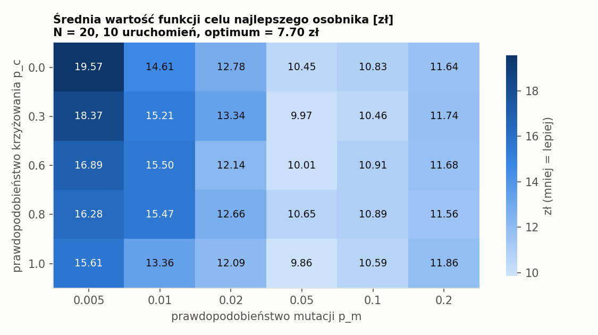
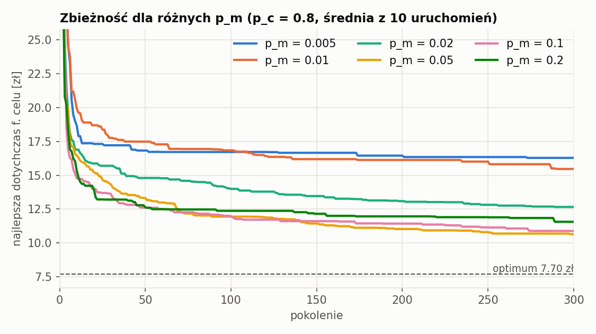
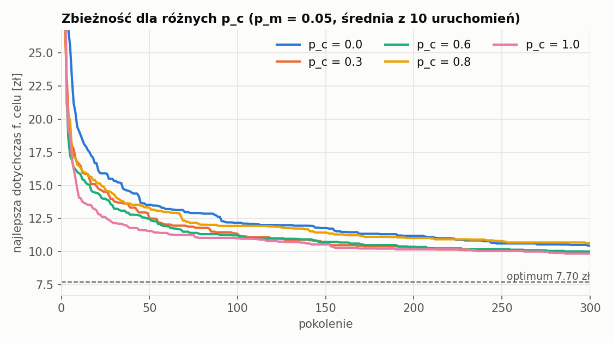
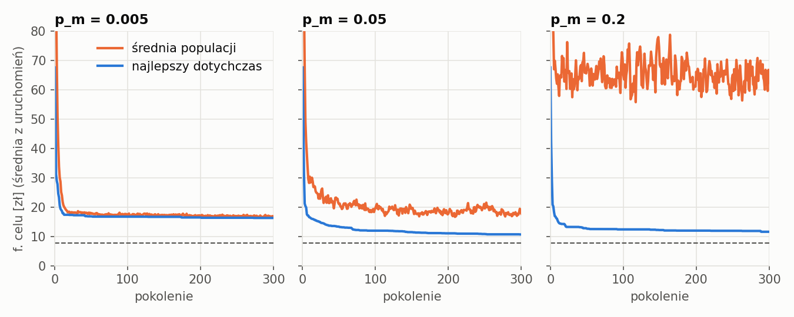
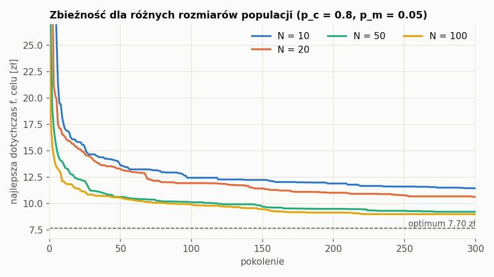

# Zadanie 1: Algorytm genetyczny – planowanie diety

## Problem

Mamy listę 21 produktów spożywczych. Dla jednej porcji każdego z nich znamy wartości odżywcze
(kcal, białko, tłuszcz, węglowodany, błonnik) i cenę. Szukamy **najtańszego dziennego
jadłospisu**, który mieści się w zakresach zapotrzebowania danej osoby (przykład: mężczyzna,
25 lat, 75 kg, umiarkowana aktywność):

| składnik    | min  | max  |
|-------------|------|------|
| energia     | 2300 kcal | 2500 kcal |
| białko      | 90 g | 160 g |
| tłuszcz     | 60 g | 90 g  |
| węglowodany | 300 g | 380 g |
| błonnik     | 30 g | 60 g  |

Każdy produkt ma też limit porcji na dzień (1–3), żeby jadłospis był realistyczny.
Dane znajdują się w [diet_data.py](diet_data.py).

## Algorytm genetyczny ([ga.py](ga.py))

| element | wybór |
|---|---|
| **Chromosom** | wektor 21 liczb całkowitych `x = (x_1, …, x_21)`, gdzie `x_i ∈ {0, …, max_i}` to liczba porcji produktu *i*. Reprezentacja całkowitoliczbowa pasuje do problemu, bo jadłospis składa się z całych porcji. Każdy chromosom spełnia limity porcji z definicji. |
| **Funkcja celu** (minimalizowana) | `f(x) = koszt(x) + W · V(x)`, gdzie `koszt(x) = Σ x_i · cena_i` [zł], a `V(x)` to suma względnych naruszeń ograniczeń: dla każdego składnika `max(0, min − s)/min + max(0, s − max)/max`. Waga kary `W = 200 zł`, czyli 1% naruszenia kosztuje 2 zł. |
| **Funkcja przystosowania** (maksymalizowana) | `F(x) = 1 / (1 + f(x))`. Zawsze `F ∈ (0, 1]`, a większe `F` oznacza tańszą dietę, która lepiej spełnia wymagania. |
| **Selekcja** | turniejowa, rozmiar turnieju `k = 3` |
| **Krzyżowanie** | jednopunktowe; para rodziców jest krzyżowana z prawdopodobieństwem `p_c`. Punkt cięcia jest losowany z przedziału 1…20. |
| **Mutacja** | dla każdego genu osobno, z prawdopodobieństwem `p_m`: gen dostaje nową losową wartość z `{0, …, max_i}` |
| **Sukcesja** | pokoleniowa: potomkowie zastępują całą populację (podstawowy AG, bez elitaryzmu). Najlepsze dotąd znalezione rozwiązanie jest zapamiętywane osobno. |
| **Warunek stopu** | osiągnięcie zadanej liczby pokoleń (300) |

Do oceny wyników program dodatkowo liczy dokładne optimum programowaniem całkowitoliczbowym
(`scipy.optimize.milp`). To optimum służy wyłącznie jako punkt odniesienia i nie jest częścią AG.
**Optymalny koszt wynosi 7,70 zł.**

## Uruchomienie

```bash
pip install numpy matplotlib scipy

# pojedyncze uruchomienie z wybranymi parametrami
python main.py --pop 20 --gen 300 --pc 0.8 --pm 0.05 --seed 1

# badania porównawcze (ok. 10 s) – wyniki trafiają do results/
python experiments.py
```

Pliki wynikowe:
- [results/summary.md](results/summary.md): tabele z wynikami i najlepsze jadłospisy
- [results/summary.csv](results/summary.csv): statystyki dla każdej konfiguracji
- [results/runs.csv](results/runs.csv): wyniki pojedynczych uruchomień
- wykresy `results/*.png` (osadzone niżej)

## Badania porównawcze

Wszystkie konfiguracje działają na tym samym zbiorze danych. Parametry: mała populacja
**N = 20**, 300 pokoleni, turniej k = 3. Każda konfiguracja jest uruchamiana **10 razy**
(ziarna 0–9).

- Eksperyment 1: siatka `p_c ∈ {0; 0,3; 0,6; 0,8; 1,0}` × `p_m ∈ {0,005; 0,01; 0,02; 0,05; 0,1; 0,2}`, łącznie 30 konfiguracji.
- Eksperyment 2 (dodatkowy): rozmiar populacji `N ∈ {10, 20, 50, 100}` przy `p_c = 0,8` i `p_m = 0,05`.

Dla każdej konfiguracji zbieramy wartość funkcji celu `f` najlepszego znalezionego osobnika.
„Dopuszczalne” to odsetek uruchomień, w których najlepszy osobnik spełnia wszystkie ograniczenia.

### Wpływ p_c i p_m (średnie f z 10 uruchomień, w zł; optimum = 7,70)



| p_c \ p_m | 0,005 | 0,01 | 0,02 | **0,05** | 0,1 | 0,2 |
|---|---|---|---|---|---|---|
| 0,0 | 19,57 ± 3,22 | 14,61 ± 1,64 | 12,78 ± 1,50 | 10,45 ± 0,86 | 10,83 ± 0,68 | 11,64 ± 0,51 |
| 0,3 | 18,37 ± 3,02 | 15,21 ± 1,95 | 13,34 ± 1,91 | 9,97 ± 0,79 | 10,46 ± 0,60 | 11,74 ± 0,51 |
| 0,6 | 16,89 ± 3,73 | 15,50 ± 2,75 | 12,14 ± 1,77 | 10,01 ± 1,13 | 10,91 ± 0,67 | 11,68 ± 0,81 |
| 0,8 | 16,28 ± 2,73 | 15,47 ± 2,59 | 12,66 ± 2,49 | 10,65 ± 1,16 | 10,89 ± 0,93 | 11,56 ± 0,77 |
| 1,0 | 15,61 ± 2,92 | 13,36 ± 2,58 | 12,09 ± 1,56 | **9,86 ± 1,00** | 10,59 ± 0,61 | 11,86 ± 0,52 |

Pełna tabela (min, max, odsetek rozwiązań dopuszczalnych, pokolenie, w którym znaleziono
najlepszego osobnika) jest w [results/summary.md](results/summary.md).

### Przebieg zbieżności





### Rozmiar populacji (p_c = 0,8, p_m = 0,05)

| N | średnia f [zł] | odch. std | min | luka do optimum | trafienia optimum |
|---|---|---|---|---|---|
| 10  | 11,46 | 1,06 | 9,20 | 48,8% | 0/10 |
| 20  | 10,65 | 1,16 | 8,40 | 38,4% | 0/10 |
| 50  | 9,24  | 0,82 | **7,70** | 20,0% | 1/10 |
| 100 | 9,01  | 0,71 | **7,70** | 17,1% | 1/10 |



### Przykładowy wynik (N = 20, p_c = 0,8, p_m = 0,05, seed 5)

```
2 x Płatki owsiane (100 g), 1 x Chleb pełnoziarnisty (100 g), 2 x Makaron (100 g),
1 x Soczewica (100 g), 1 x Masło orzechowe (30 g), 3 x Oliwa z oliwek (10 g)
koszt 8,40 zł | 2474 kcal, białko 91,5 g, tłuszcz 66,5 g, węglowodany 365 g, błonnik 46 g
```

Optimum (ILP): 2 × płatki owsiane, 2 × makaron, 1 × soczewica, 2 × masło orzechowe,
2 × oliwa, koszt **7,70 zł**.

## Wnioski

1. **Najważniejszym parametrem jest prawdopodobieństwo mutacji.** Najlepsze wyniki daje
   `p_m = 0,05` przy każdym `p_c`. Przy 21 genach oznacza to średnio około jedną zmianę na
   chromosom.
   - **Za mała mutacja** (`p_m ≤ 0,01`) prowadzi do przedwczesnej zbieżności. Po ok. 20
     pokoleniach średnia populacji pokrywa się z najlepszym osobnikiem, czyli populacja składa
     się z kopii jednego osobnika (wykres `population_mean.png`). Wyniki są słabe (13–20 zł)
     i mocno się różnią między uruchomieniami (odch. std 2–4 zł). Przy `p_m = 0,005` i `p_c < 1`
     najlepsze rozwiązanie pojawia się średnio już w 60.–80. pokoleniu i później się nie poprawia.
   - **Za duża mutacja** (`p_m = 0,2`, ok. 4 geny na osobnika) niszczy dobre rozwiązania.
     Średnia populacji utrzymuje się na poziomie 60–70 zł, a algorytm zachowuje się podobnie do
     przeszukiwania losowego. Wyniki są powtarzalne (małe odchylenie), ale wyraźnie gorsze
     (ok. 11,6 zł). Rośnie też liczba uruchomień kończących się rozwiązaniem niedopuszczalnym.
2. **Krzyżowanie ma mniejszy wpływ niż mutacja.** Jego efekt jest najlepiej widoczny przy małej
   mutacji: przy `p_m = 0,005` wynik poprawia się z 19,6 zł (`p_c = 0`) do 15,6 zł
   (`p_c = 1`), bo krzyżowanie dodatkowo miesza materiał genetyczny. Przy dobrze dobranym `p_m`
   wszystkie wartości `p_c > 0` dają podobne wyniki (9,9–10,7 zł). Różnice są mniejsze niż
   odchylenie standardowe, więc przy 10 uruchomieniach nie można ich uznać za istotne. Sama
   mutacja (`p_c = 0`) zbiega wyraźnie wolniej w pierwszych 100 pokoleniach (wykres
   `convergence_pc.png`).
3. **Mała populacja (N = 20) nie wystarcza do znalezienia optimum.** Przy N = 20 żadne z 300
   uruchomień nie trafiło w 7,70 zł. Najlepszy wynik to 8,40 zł (+9%), a średnio dla najlepszych
   parametrów +28%. Większa populacja pomaga: przy N = 50 i N = 100 optimum zostało znalezione,
   a średnia luka spadła do ok. 17–20%. Jest to jednak okupione 2,5–5 razy większą liczbą
   wywołań funkcji przystosowania.
4. **Kara za naruszenie ograniczeń działa.** Gdy najlepszy osobnik był niedopuszczalny, łączne
   naruszenie wynosiło najwyżej 1% (np. 2–5 kcal ponad limit). Przy N = 20 rozwiązanie
   dopuszczalne znaleziono w 70–100% uruchomień, w zależności od konfiguracji.
5. **Możliwe ulepszenia** (wykraczające poza podstawowy AG): elitaryzm, który chroni najlepszego
   osobnika przed zniszczeniem przez mutację, mutacja ±1 porcja zamiast losowego przypisania
   wartości oraz większa populacja albo więcej pokoleń.
