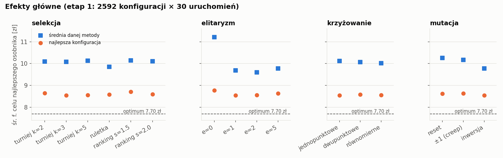
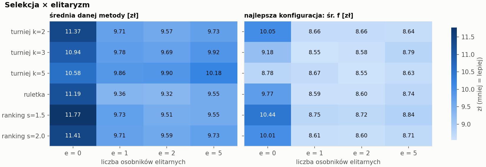
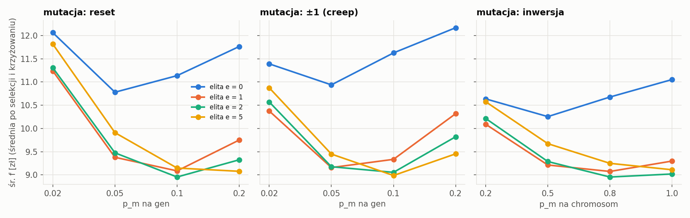
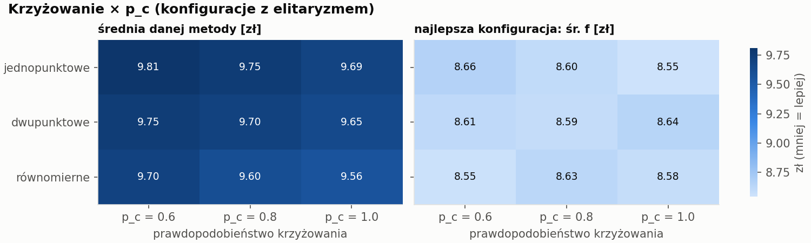
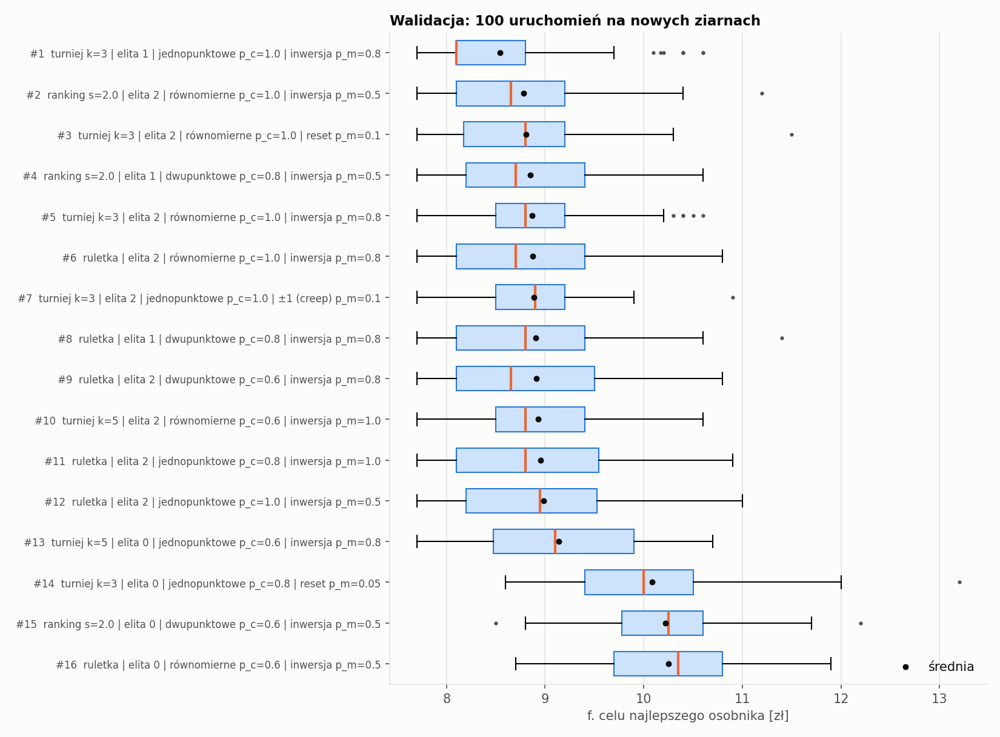
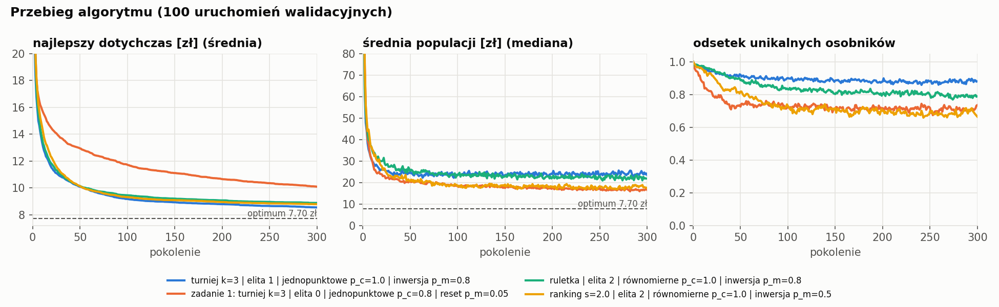
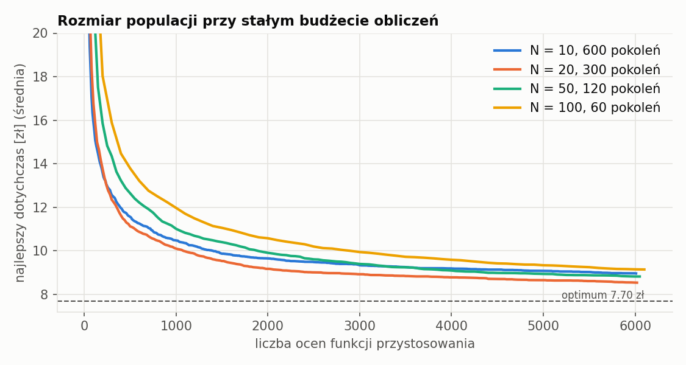

# Zadanie 2: rozszerzony algorytm genetyczny – planowanie diety

Rozszerzenie algorytmu genetycznego z [zadania 1](../Task-1/README.md) o elitaryzm, nowe metody
selekcji, krzyżowania i mutacji. Następnie porównujemy wszystkie kombinacje i wybieramy najlepszą
dla problemu diety.

Problem, dane ([diet_data.py](diet_data.py)), chromosom i funkcja przystosowania są takie same jak
w zadaniu 1:

- chromosom to 21 liczb całkowitych `x_i ∈ {0, …, max_i}` (liczba porcji produktu *i*),
- funkcja celu (minimalizowana) `f(x) = koszt(x) + 200 · V(x)`, gdzie `V(x)` to względne naruszenie
  zakresów składników odżywczych,
- przystosowanie `F(x) = 1 / (1 + f(x))`,
- optimum (z programowania całkowitoliczbowego, tylko do oceny wyników) wynosi **7,70 zł**.

## Zaimplementowane operatory ([ga.py](ga.py))

Każdy operator jest wybierany w konfiguracji `GAConfig` (lub z linii poleceń w [main.py](main.py)).
Pogrubione elementy są nowe w zadaniu 2.

### Selekcja

| metoda | działanie | parametr |
|---|---|---|
| turniejowa | z populacji losujemy `k` osobników, rodzicem zostaje najlepszy z nich | rozmiar turnieju `k` |
| **ruletkowa** | osobnik *i* jest wybierany z prawdopodobieństwem `F_i / Σ F_j` (proporcjonalnie do przystosowania) | — |
| **rankingowa (liniowa)** | osobniki sortujemy od najgorszego (ranga 0) do najlepszego (ranga N−1) i losujemy z prawdopodobieństwem `P(r) = (2 − s)/N + 2r(s − 1)/(N(N − 1))`. Najlepszy dostaje średnio `s` kopii, najgorszy `2 − s`. Liczy się tylko kolejność, a nie wartość `F` | presja selekcyjna `s ∈ [1, 2]` |

### Elitaryzm (selekcja elitarna)

**Elitaryzm** przenosi `e` najlepszych osobników do następnego pokolenia bez zmian (bez krzyżowania
i mutacji). Pozostałe `N − e` miejsc zajmują potomkowie. Działa z każdą metodą selekcji, a `e = 0`
oznacza brak elitaryzmu, jak w zadaniu 1. Dzięki temu najlepsze rozwiązanie w populacji nigdy się
nie pogarsza.

### Krzyżowanie

Rodzice są łączeni w pary, a para jest krzyżowana z prawdopodobieństwem `p_c`. Każda metoda
wyznacza, które geny rodzice wymieniają:

| metoda | wymieniane geny | przykład (A = `aaaaaaaa`, B = `bbbbbbbb`) |
|---|---|---|
| jednopunktowe | wszystkie od losowego punktu cięcia do końca | `aaab bbbb` |
| **dwupunktowe** | środkowy fragment między dwoma losowymi punktami cięcia | `aa bbb aaa` |
| **równomierne** | każdy gen niezależnie z prawdopodobieństwem 1/2 | `abaab bab` |

### Mutacja

| metoda | działanie | `p_m` oznacza |
|---|---|---|
| reset | gen dostaje nową losową wartość z `{0, …, max_i}` | prawdopodobieństwo na gen |
| **inwersja** | w chromosomie losujemy odcinek `[a, b]` i odwracamy kolejność jego genów. Produkty mają różne limity porcji, więc wartość przeniesiona na pozycję o mniejszym limicie jest przycinana do `max_i` (naprawa) | prawdopodobieństwo na chromosom |
| **±1 (creep)** | gen zmienia się o jedną porcję w górę lub w dół. Krok, który wyszedłby poza zakres, jest wykonywany w przeciwną stronę | prawdopodobieństwo na gen |

Treść zadania wymaga jednego nowego operatora mutacji. Inwersja spełnia ten wymóg. Mutację ±1
dodano dodatkowo, bo we wnioskach z zadania 1 wskazano ją jako możliwe ulepszenie.

Przykład inwersji odcinka `[4, 9]`:

```
przed: [2 1 0 2 | 1 0 2 0 1 2 | 0 1 ...]
po:    [2 1 0 2 | 2 1 0 2 0 1 | 0 1 ...]
```

### Zgodność z zadaniem 1

Przy ustawieniach domyślnych (turniej `k = 3`, `e = 0`, krzyżowanie jednopunktowe, reset) kod
zużywa liczby losowe w tej samej kolejności co w zadaniu 1. Te same ziarna dają więc **identyczne**
wyniki. Sprawdzono to na 90 uruchomieniach z różnymi `N`, `p_c` i `p_m`.

## Uruchomienie

```bash
pip install numpy matplotlib scipy

# pojedyncze uruchomienie, np. zwycięska konfiguracja
python main.py --selection tournament --k 3 --elite 1 --crossover one_point --pc 1.0 \
               --mutation inversion --pm 0.8 --seed 1

# pełne badania (ok. 80 tys. uruchomień AG, kilkanaście minut na wielu rdzeniach)
python experiments.py
```

## Metodyka badań ([experiments.py](experiments.py))

Wszystkie konfiguracje mają **ten sam budżet** co w zadaniu 1: populacja N = 20 i 300 pokoleń,
czyli ok. 6000 ocen funkcji przystosowania. Wynikiem uruchomienia jest wartość funkcji celu `f`
najlepszego znalezionego osobnika (w zł, mniej znaczy lepiej).

**Etap 1: przegląd pełnej siatki.** Sprawdzamy wszystkie kombinacje metod i parametrów, czyli
6 · 4 · 3 · 3 · 12 = **2592 konfiguracje**, każdą w **30 uruchomieniach** (ziarna 0–29):

| czynnik | poziomy |
|---|---|
| selekcja | turniej `k ∈ {2, 3, 5}`, ruletka, ranking `s ∈ {1,5; 2,0}` |
| elitaryzm | `e ∈ {0, 1, 2, 5}` |
| krzyżowanie | jednopunktowe, dwupunktowe, równomierne |
| `p_c` | 0,6; 0,8; 1,0 |
| mutacja i `p_m` | reset `{0,02; 0,05; 0,1; 0,2}`, ±1 `{0,02; 0,05; 0,1; 0,2}`, inwersja `{0,2; 0,5; 0,8; 1,0}` |

**Etap 2: walidacja.** Wybierając najlepszą z 2592 średnich, łatwo trafić na konfigurację, która
miała po prostu szczęście w losowaniu. Dlatego kandydatów uruchamiamy ponownie **100 razy na nowych
ziarnach** (1000–1099). Kandydaci to:

- 10 najlepszych konfiguracji z etapu 1,
- najlepsza konfiguracja każdej metody selekcji (bez i z elitaryzmem), krzyżowania i mutacji,
- konfiguracja z zadania 1.

O wyborze decyduje średnia z walidacji. Różnice sprawdzamy jednostronnym testem Manna–Whitneya.

**Etap 3: rozmiar populacji.** Zwycięską konfigurację uruchamiamy z innym `N` przy tym samym
budżecie ocen (N · pokolenia ≈ 6000).

Pełne wyniki są w [results/summary.md](results/summary.md), [results/screening.csv](results/screening.csv)
(wszystkie 2592 konfiguracje), [results/validation.csv](results/validation.csv) i
[results/validation_runs.csv](results/validation_runs.csv) (pojedyncze uruchomienia).

## Wyniki

### Efekty główne



Dla każdego poziomu czynnika podajemy dwie liczby:

- **średnia danej metody**: średnia ze wszystkich konfiguracji z tym poziomem. Mówi, jak metoda
  sprawdza się „przeciętnie”, także przy źle dobranych pozostałych parametrach.
- **najlepsza konfiguracja**: wynik najlepiej dostrojonej konfiguracji z tym poziomem.

| czynnik | poziom | średnia danej metody [zł] | najlepsza konfiguracja [zł] |
|---|---|---|---|
| elitaryzm | e = 0 | 11,21 | 8,78 |
| | e = 1 | 9,69 | **8,55** |
| | e = 2 | **9,60** | **8,55** |
| | e = 5 | 9,78 | 8,63 |
| selekcja | turniej k = 2 / 3 / 5 | 10,10 / 10,08 / 10,13 | 8,64 / **8,55** / **8,55** |
| | ruletka | **9,85** | 8,59 |
| | ranking s = 1,5 / 2,0 | 10,14 / 10,11 | 8,72 / 8,60 |
| krzyżowanie | jednopunktowe | 10,12 | **8,55** |
| | dwupunktowe | 10,06 | 8,59 |
| | równomierne | **10,02** | **8,55** |
| mutacja | reset | 10,26 | 8,62 |
| | ±1 (creep) | 10,17 | 8,64 |
| | inwersja | **9,77** | **8,55** |

Odchylenie standardowe pojedynczej konfiguracji to ok. 0,65 zł, więc błąd standardowy średniej z
30 uruchomień wynosi ok. 0,12 zł. Różnice mniejsze niż ok. 0,25 zł w etapie 1 nie są
rozstrzygające i właśnie dlatego potrzebna jest walidacja.

### Selekcja i elitaryzm



### Mutacja



Punkty na wykresie to średnia po wszystkich metodach selekcji i krzyżowania.

### Krzyżowanie



### Walidacja najlepszych kandydatów (100 uruchomień, nowe ziarna)



| # | konfiguracja | śr. f etap 1 [zł] | **śr. f walidacja [zł]** | odch. std | mediana | dopuszczalne | trafienia opt. | p (Mann–Whitney) |
|---|---|---|---|---|---|---|---|---|
| **1** | **turniej k=3, elita 1, jednopunktowe p_c=1,0, inwersja p_m=0,8** | 8,55 | **8,54** | 0,71 | **8,10** | 99% | 6% | — |
| 2 | ranking s=2,0, elita 2, równomierne p_c=1,0, inwersja p_m=0,5 | 8,60 | 8,78 | 0,71 | 8,65 | 99% | 5% | 0,001 |
| 3 | turniej k=3, elita 2, równomierne p_c=1,0, reset p_m=0,1 | 8,62 | 8,81 | 0,68 | 8,80 | 100% | **8%** | 0,0002 |
| 6 | ruletka, elita 2, równomierne p_c=1,0, inwersja p_m=0,8 | 8,60 | 8,88 | 0,76 | 8,70 | 94% | 4% | 0,0002 |
| 7 | turniej k=3, elita 2, jednopunktowe p_c=1,0, ±1 p_m=0,1 | 8,64 | 8,89 | 0,53 | 8,90 | 100% | 1% | < 10⁻⁶ |
| 13 | turniej k=5, **bez elity**, jednopunktowe p_c=0,6, inwersja p_m=0,8 | 8,78 | 9,14 | 0,86 | 9,10 | 94% | 3% | < 10⁻⁷ |
| 14 | **zadanie 1**: turniej k=3, bez elity, jednopunktowe p_c=0,8, reset p_m=0,05 | 10,47 | 10,09 | 0,89 | 10,00 | 93% | 0% | < 10⁻²⁴ |
| 15 | ranking s=2,0, bez elity, dwupunktowe p_c=0,6, inwersja p_m=0,5 | 10,01 | 10,22 | 0,68 | 10,25 | 95% | 0% | < 10⁻²⁶ |
| 16 | ruletka, bez elity, równomierne p_c=0,6, inwersja p_m=0,5 | 9,77 | 10,25 | 0,72 | 10,35 | 92% | 0% | < 10⁻²⁶ |

Pełna tabela z 16 kandydatami jest w [results/summary.md](results/summary.md).

Najlepsza konfiguracja każdej metody selekcji (walidacja):

| selekcja | bez elitaryzmu | z elitaryzmem |
|---|---|---|
| turniej | 9,14 zł (k = 5) | **8,54 zł** (k = 3, e = 1) |
| ruletka | 10,25 zł | 8,88 zł (e = 2) |
| ranking | 10,22 zł (s = 2,0) | 8,78 zł (s = 2,0, e = 2) |

### Przebieg algorytmu



### Rozmiar populacji przy stałym budżecie



| N, pokolenia | śr. f [zł] | mediana | trafienia opt. |
|---|---|---|---|
| 10, 600 | 8,96 | 8,80 | 2% |
| **20, 300** | **8,54** | **8,10** | **6%** |
| 50, 120 | 8,82 | 8,60 | 3% |
| 100, 60 | 9,14 | 9,10 | 1% |

## Najlepsza kombinacja

| element | wybór |
|---|---|
| selekcja | turniejowa, `k = 3` |
| elitaryzm | `e = 1` (najlepszy osobnik przechodzi bez zmian) |
| krzyżowanie | jednopunktowe, `p_c = 1,0` |
| mutacja | inwersja, `p_m = 0,8` na chromosom |
| populacja | `N = 20`, 300 pokoleń |

Porównanie z zadaniem 1 w walidacji (100 uruchomień):

| | zadanie 1 | zadanie 2 |
|---|---|---|
| średnia f | 10,09 zł | **8,54 zł** (−15%) |
| mediana | 10,00 zł | **8,10 zł** |
| luka do optimum | 31% | **11%** |
| najgorsze uruchomienie | 13,20 zł | **10,60 zł** |
| rozwiązanie dopuszczalne | 93% | **99%** |
| znalezione optimum 7,70 zł | 0% | **6%** |

Konfiguracja jest istotnie lepsza od każdej innej sprawdzonej w walidacji (test Manna–Whitneya,
p < 0,002). Jako jedyna z czołówki nie straciła na wyniku przy przejściu na nowe ziarna (8,55 →
8,54 zł). Pozostałe kandydatki pogorszyły się o 0,2–0,4 zł, co pokazuje, że ich wynik w etapie 1
był po części szczęściem.

## Wnioski

1. **Elitaryzm daje największą poprawę.** Średnia danej metody wynosi 11,21 zł dla `e = 0`
   i 9,60 zł dla `e = 2`. Bez elitaryzmu najlepsze rozwiązanie łatwo ginie przez mutację (patrz zadanie 1).
   Wystarczy 1–2 osobników elitarnych. Przy `e = 5` (25% populacji) wyniki są nieco gorsze, bo
   populacja szybciej traci różnorodność, szczególnie przy silnej selekcji (turniej `k = 5`,
   `e = 5`: 10,18 zł).

2. **Elitaryzm zmienia optymalne prawdopodobieństwo mutacji.** Bez elity najlepsze jest
   `p_m = 0,05` dla resetu, a z elitą `p_m = 0,1`. Dla inwersji optimum przesuwa się z 0,5 do 0,8
   (wykres `mutation_rates.png`). Skoro najlepszy osobnik jest chroniony, można mocniej mutować
   resztę populacji i szerzej przeszukiwać przestrzeń.

3. **Metoda selekcji ma znaczenie głównie bez elitaryzmu.**
   - Bez elity wyraźnie wygrywa turniej (najlepiej `k = 5`: 9,14 zł). Ruletka i ranking osiągają
     tylko ok. 10,2 zł.
   - Ruletka przy `F = 1/(1 + f)` ma słabą presję w późnej fazie: jadłospisy za 8,5 zł i 10 zł mają
     `F` równe 0,105 i 0,091, więc lepszy jest wybierany tylko o ok. 15% częściej i łatwo ginie.
   - Z elitaryzmem różnice między metodami się zacierają (8,54–8,88 zł). Ruletka ma wtedy nawet
     najlepszą średnią danej metody (9,32–9,36 zł przy `e = 1–2`): słaba presja utrzymuje różnorodność,
     a elita pilnuje najlepszego wyniku.
   - Odsetek unikalnych osobników (wykres `final_convergence.png`) jest najwyższy dla turnieju
     z jedną elitą i inwersją (ok. 0,9), a najniższy dla konfiguracji z zadania 1 i dla rankingu
     z `s = 2,0` (ok. 0,7).

4. **Inwersja to najlepszy operator mutacji dla tego problemu.** Ma najlepszą średnią danej metody
   (9,77 zł wobec 10,17–10,26 zł) i wygrywa walidację.
   - Inwersja przenosi porcje między produktami: w 91% przypadków łączna liczba porcji się nie
     zmienia. Działa więc jak ruch „zamień część produktu A na produkt B”, czyli dokładnie taki,
     jakiego potrzeba blisko optimum, gdzie trzeba wymienić droższy produkt na tańszy przy podobnej
     kaloryczności.
   - Na 555 dobrych, ale nieoptymalnych rozwiązaniach z walidacji pojedyncza inwersja poprawiała
     wynik w 0,84% prób, mutacja ±1 w 0,58%, a reset tylko w 0,44%.
   - Reset ma jednak najwięcej trafień w dokładne optimum (8% w walidacji wobec 6%), bo pozwala na
     duże skoki. Daje za to gorszą średnią.
   - Mutacja ±1 daje najstabilniejsze wyniki (najmniejsze odchylenie, 0,53 zł) i zawsze rozwiązanie
     dopuszczalne, ale rzadko trafia w optimum (1%), bo małe kroki utrudniają wyjście z optimum
     lokalnego.

5. **Krzyżowanie ma najmniejszy wpływ.** Średnie danej metody dla trzech metod różnią się o 0,1 zł
   (równomierne 10,02, dwupunktowe 10,06, jednopunktowe 10,12 zł), a najlepsze konfiguracje mieszczą
   się w granicach szumu. Lekko lepsze jest wyższe `p_c` (10,11 → 10,03 zł dla 0,6 → 1,0). To
   zgodne z zadaniem 1, gdzie krzyżowanie też miało mniejszy wpływ niż mutacja.

6. **Rozmiar populacji N = 20 jest dobrym kompromisem przy stałym budżecie.** Mniejsza populacja
   (N = 10) szybciej traci różnorodność, a większe (N = 50, 100) mają za mało pokoleń, żeby
   dopracować rozwiązanie. W zadaniu 1 większa populacja pomagała, ale tam miała też więcej ocen
   funkcji przystosowania.

7. **Optimum nadal jest trudne do znalezienia.** Nawet najlepsza konfiguracja trafia w 7,70 zł tylko
   w 6% uruchomień, choć mediana (8,10 zł) jest już blisko. Typowy wynik końcowy to optimum lokalne,
   od którego dzieli kilka genów (np. 8,10 lub 8,40 zł). Dalszą poprawę mogłoby dać połączenie
   inwersji z resetem albo lokalne przeszukiwanie najlepszego osobnika (algorytm memetyczny).

## Pliki

| plik | zawartość |
|---|---|
| [ga.py](ga.py) | problem, wszystkie operatory, główna pętla AG |
| [main.py](main.py) | pojedyncze uruchomienie z wyborem operatorów |
| [experiments.py](experiments.py) | wszystkie badania, tabele i wykresy |
| [diet_data.py](diet_data.py) | dane (bez zmian względem zadania 1) |
| [results/summary.md](results/summary.md) | wszystkie tabele wyników wygenerowane automatycznie |
| [results/screening.csv](results/screening.csv) | etap 1: statystyki 2592 konfiguracji |
| [results/validation.csv](results/validation.csv), [results/validation_runs.csv](results/validation_runs.csv) | etap 2: statystyki i pojedyncze uruchomienia |
| `results/*.png` | wykresy osadzone wyżej |
