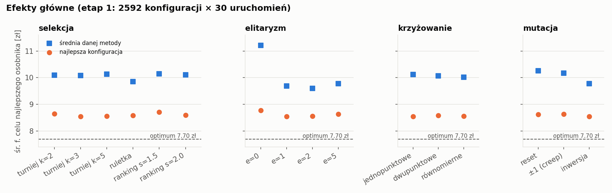
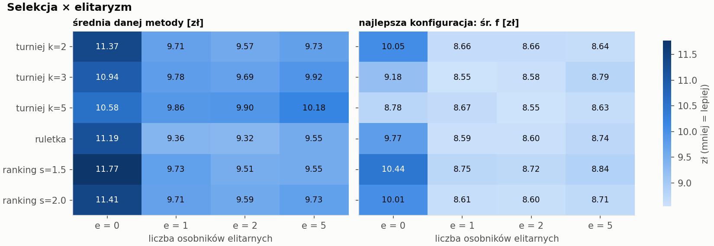
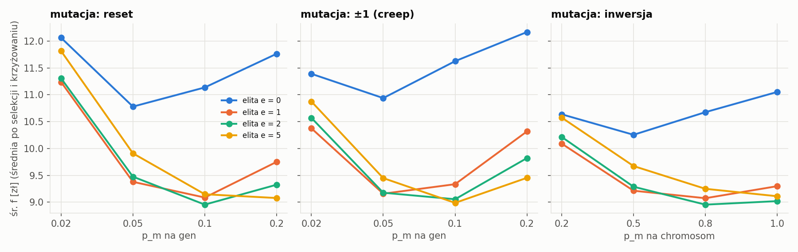
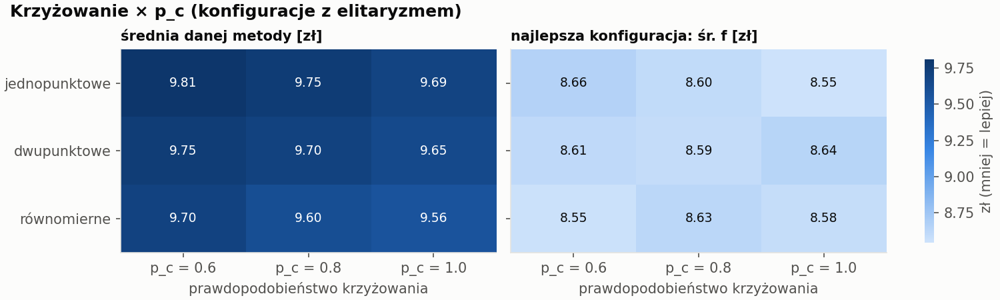
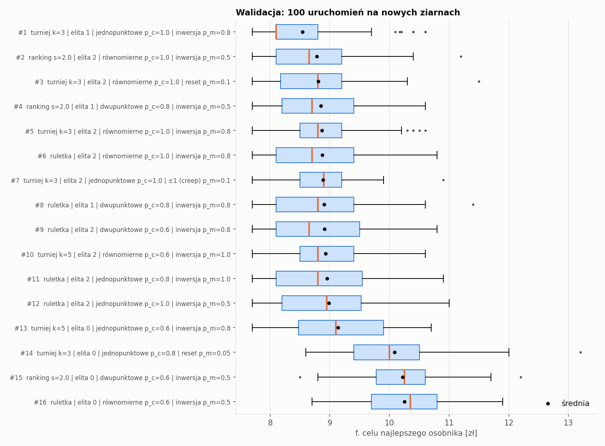
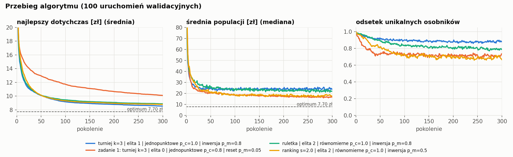
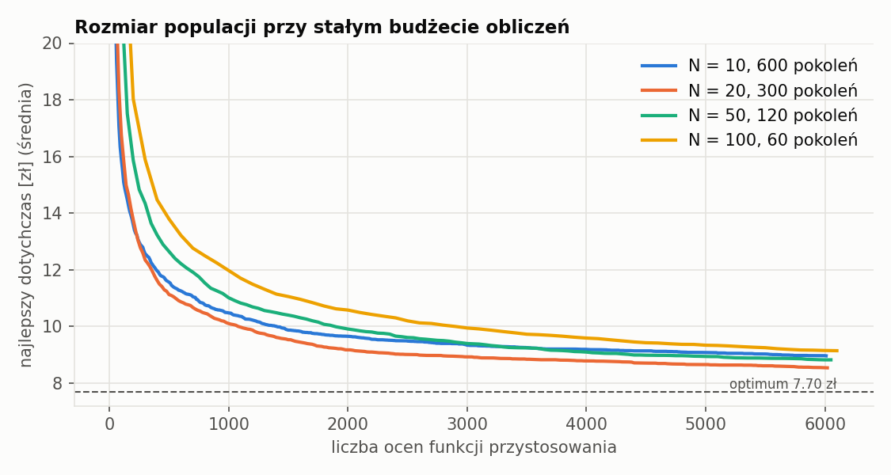

# Sprawozdanie z wyników – zadanie 2

**Cel:** dobrać najlepszą kombinację selekcji, elitaryzmu, krzyżowania i mutacji dla AG
rozwiązującego problem diety. Optimum (ILP) wynosi **7,70 zł**.

**Warunki:** każda konfiguracja ma populację N = 20 i 300 pokoleń (ok. 6000 ocen).

**Przebieg badań:**

1. Przegląd siatki: 2592 konfiguracje × 30 uruchomień (ziarna 0–29).
2. Walidacja: 16 kandydatów × 100 uruchomień na nowych ziarnach (1000–1099).
3. Rozmiar populacji przy stałym budżecie.

**Oznaczenia w tabelach:**

- **średnia danej metody:** średnia ze wszystkich konfiguracji, w których występuje dana metoda
  (poziom czynnika), niezależnie od ustawień pozostałych parametrów.
- **najlepsza konfiguracja:** najlepiej dostrojona konfiguracja z tym poziomem.
- **trafienia opt.:** odsetek uruchomień, które znalazły 7,70 zł.
- **luka do opt.:** o ile procent średni wynik jest gorszy od optimum.
- **dopuszczalne:** odsetek uruchomień, które zakończyły się jadłospisem spełniającym wszystkie
  normy.
- **śr. pokolenie best:** średnie pokolenie, w którym znaleziono najlepsze rozwiązanie.

---

## Etap 1: przegląd siatki (2592 konfiguracji × 30 uruchomień)

### 1. Ogólne zestawienie wyników



#### Selekcja

| selekcja | średnia danej metody [zł] | najlepsza konfiguracja: śr. f [zł] | trafienia opt. | najlepsza konfiguracja |
|---|---|---|---|---|
| turniej k=2 | 10,10 | 8,64 | 7% | turniej k=2, elita 5, równomierne p_c=1,0, inwersja p_m=0,8 |
| turniej k=3 | 10,08 | 8,55 | 7% | turniej k=3, elita 1, jednopunktowe p_c=1,0, inwersja p_m=0,8 |
| turniej k=5 | 10,13 | 8,55 | 3% | turniej k=5, elita 2, równomierne p_c=0,6, inwersja p_m=1,0 |
| ruletka | 9,85 | 8,59 | 0% | ruletka, elita 1, dwupunktowe p_c=0,8, inwersja p_m=0,8 |
| ranking s=1,5 | 10,14 | 8,72 | 10% | ranking s=1,5, elita 2, jednopunktowe p_c=1,0, inwersja p_m=0,5 |
| ranking s=2,0 | 10,11 | 8,60 | 7% | ranking s=2,0, elita 2, równomierne p_c=1,0, inwersja p_m=0,5 |

#### Elitaryzm

| elita | średnia danej metody [zł] | najlepsza konfiguracja: śr. f [zł] | trafienia opt. | najlepsza konfiguracja |
|---|---|---|---|---|
| e = 0 | 11,21 | 8,78 | 0% | turniej k=5, elita 0, jednopunktowe p_c=0,6, inwersja p_m=0,8 |
| e = 1 | 9,69 | 8,55 | 7% | turniej k=3, elita 1, jednopunktowe p_c=1,0, inwersja p_m=0,8 |
| e = 2 | 9,60 | 8,55 | 3% | turniej k=5, elita 2, równomierne p_c=0,6, inwersja p_m=1,0 |
| e = 5 | 9,78 | 8,63 | 17% | turniej k=5, elita 5, równomierne p_c=0,8, reset p_m=0,2 |

#### Krzyżowanie

| krzyżowanie | średnia danej metody [zł] | najlepsza konfiguracja: śr. f [zł] | trafienia opt. | najlepsza konfiguracja |
|---|---|---|---|---|
| jednopunktowe | 10,12 | 8,55 | 7% | turniej k=3, elita 1, jednopunktowe p_c=1,0, inwersja p_m=0,8 |
| dwupunktowe | 10,06 | 8,59 | 0% | ruletka, elita 1, dwupunktowe p_c=0,8, inwersja p_m=0,8 |
| równomierne | 10,02 | 8,55 | 3% | turniej k=5, elita 2, równomierne p_c=0,6, inwersja p_m=1,0 |

#### Prawdopodobieństwo krzyżowania

| p_c | średnia danej metody [zł] | najlepsza konfiguracja: śr. f [zł] | trafienia opt. | najlepsza konfiguracja |
|---|---|---|---|---|
| 0,6 | 10,11 | 8,55 | 3% | turniej k=5, elita 2, równomierne p_c=0,6, inwersja p_m=1,0 |
| 0,8 | 10,07 | 8,59 | 0% | ruletka, elita 1, dwupunktowe p_c=0,8, inwersja p_m=0,8 |
| 1,0 | 10,03 | 8,55 | 7% | turniej k=3, elita 1, jednopunktowe p_c=1,0, inwersja p_m=0,8 |

#### Mutacja

| mutacja | średnia danej metody [zł] | najlepsza konfiguracja: śr. f [zł] | trafienia opt. | najlepsza konfiguracja |
|---|---|---|---|---|
| reset | 10,26 | 8,62 | 17% | turniej k=3, elita 2, równomierne p_c=1,0, reset p_m=0,1 |
| ±1 (creep) | 10,17 | 8,64 | 7% | turniej k=3, elita 2, jednopunktowe p_c=1,0, ±1 (creep) p_m=0,1 |
| inwersja | 9,77 | 8,55 | 7% | turniej k=3, elita 1, jednopunktowe p_c=1,0, inwersja p_m=0,8 |

**Wniosek:**

- Największy wpływ ma **elitaryzm**: średnia danej metody wynosi 11,21 zł dla e = 0 i 9,60 zł dla e = 2.
- Drugi pod względem wpływu jest **rodzaj mutacji**: inwersja daje 9,77 zł, a reset 10,26 zł.
- **Krzyżowanie** i `p_c` zmieniają średnią o ok. 0,1 zł, czyli w granicach szumu.
- Najlepsze konfiguracje wszystkich metod mieszczą się w 8,55–8,78 zł. W prawie wszystkich
  najlepszych konfiguracjach występuje elita i inwersja.

### 2. Selekcja × elitaryzm



**Wniosek:**

- Każda metoda selekcji bez elity (kolumna e = 0) wypada wyraźnie gorzej.
- Bez elity wygrywa turniej k = 5 (8,78 zł), który najsilniej chroni dobre osobniki.
- Z elitą różnice między metodami selekcji maleją do ok. 0,2 zł.
- Wystarczy e = 1–2. Przy e = 5 wyniki lekko się pogarszają, bo spada różnorodność populacji.

### 3. Mutacja i jej prawdopodobieństwo



| mutacja, p_m | średnia danej metody [zł] | najlepsza konfiguracja: śr. f [zł] | trafienia opt. | najlepsza konfiguracja |
|---|---|---|---|---|
| reset, 0,02 | 11,61 | 9,70 | 0% | ranking s=1,5, elita 1, równomierne p_c=1,0, reset p_m=0,02 |
| reset, 0,05 | 9,89 | 8,75 | 13% | ranking s=1,5, elita 1, jednopunktowe p_c=1,0, reset p_m=0,05 |
| reset, 0,1 | 9,58 | 8,62 | 17% | turniej k=3, elita 2, równomierne p_c=1,0, reset p_m=0,1 |
| reset, 0,2 | 9,98 | 8,63 | 17% | turniej k=5, elita 5, równomierne p_c=0,8, reset p_m=0,2 |
| ±1 (creep), 0,02 | 10,80 | 9,27 | 0% | ranking s=1,5, elita 1, równomierne p_c=1,0, ±1 (creep) p_m=0,02 |
| ±1 (creep), 0,05 | 9,68 | 8,74 | 3% | turniej k=2, elita 2, jednopunktowe p_c=0,8, ±1 (creep) p_m=0,05 |
| ±1 (creep), 0,1 | 9,75 | 8,64 | 7% | turniej k=3, elita 2, jednopunktowe p_c=1,0, ±1 (creep) p_m=0,1 |
| ±1 (creep), 0,2 | 10,44 | 8,91 | 3% | turniej k=5, elita 5, równomierne p_c=0,8, ±1 (creep) p_m=0,2 |
| inwersja, 0,2 | 10,38 | 8,91 | 10% | ranking s=1,5, elita 1, równomierne p_c=0,8, inwersja p_m=0,2 |
| inwersja, 0,5 | 9,61 | 8,60 | 7% | ranking s=2,0, elita 2, równomierne p_c=1,0, inwersja p_m=0,5 |
| inwersja, 0,8 | **9,49** | **8,55** | 7% | turniej k=3, elita 1, jednopunktowe p_c=1,0, inwersja p_m=0,8 |
| inwersja, 1,0 | 9,62 | **8,55** | 3% | turniej k=5, elita 2, równomierne p_c=0,6, inwersja p_m=1,0 |

Dla resetu i ±1 `p_m` jest liczone na gen, a dla inwersji na chromosom.

**Wniosek:**

- Każda mutacja ma wyraźne optimum `p_m`: za mała nie wyprowadza z optimów lokalnych (reset
  0,02: 11,61 zł), a za duża niszczy dobre rozwiązania.
- Najlepszą średnią danej metody ma inwersja z `p_m = 0,8` (9,49 zł).
- Elitaryzm przesuwa optimum `p_m` w górę. Dla resetu rośnie z 0,05 do 0,1, a dla inwersji z 0,5
  do 0,8. Najlepszy osobnik jest chroniony, więc resztę populacji można mocniej mutować.
- Reset najczęściej trafia w dokładne optimum (do 17%), bo pozwala na duże skoki.

### 4. Krzyżowanie i jego prawdopodobieństwo



**Wniosek:** wyższe `p_c` daje niewielką poprawę (ok. 0,1 zł). Wszystkie trzy metody osiągają
8,55–8,64 zł w najlepszej konfiguracji, czyli różnią się w granicach szumu.

### 5. Najlepsze i najgorsze konfiguracje

#### 20 najlepszych konfiguracji

| konfiguracja | śr. f [zł] | odch. std | mediana | min | max | luka do opt. | dopuszczalne | trafienia opt. | śr. pokolenie best |
|---|---|---|---|---|---|---|---|---|---|
| turniej k=3, elita 1, jednopunktowe p_c=1,0, inwersja p_m=0,8 | 8,55 | 0,67 | 8,25 | 7,70 | 10,50 | 11,0% | 100% | 7% | 174 |
| turniej k=5, elita 2, równomierne p_c=0,6, inwersja p_m=1,0 | 8,55 | 0,64 | 8,25 | 7,70 | 10,40 | 11,1% | 97% | 3% | 160 |
| turniej k=3, elita 2, równomierne p_c=1,0, inwersja p_m=0,8 | 8,58 | 0,64 | 8,50 | 7,70 | 10,47 | 11,4% | 93% | 7% | 150 |
| ruletka, elita 1, dwupunktowe p_c=0,8, inwersja p_m=0,8 | 8,59 | 0,61 | 8,55 | 8,10 | 10,60 | 11,6% | 97% | 0% | 151 |
| ruletka, elita 2, równomierne p_c=1,0, inwersja p_m=0,8 | 8,60 | 0,59 | 8,50 | 7,70 | 9,80 | 11,6% | 100% | 7% | 164 |
| ruletka, elita 2, jednopunktowe p_c=0,8, inwersja p_m=1,0 | 8,60 | 0,85 | 8,20 | 7,70 | 10,50 | 11,7% | 100% | 10% | 158 |
| ranking s=2,0, elita 2, równomierne p_c=1,0, inwersja p_m=0,5 | 8,60 | 0,64 | 8,50 | 7,70 | 10,20 | 11,7% | 97% | 7% | 156 |
| ruletka, elita 2, dwupunktowe p_c=0,6, inwersja p_m=0,8 | 8,61 | 0,61 | 8,50 | 7,70 | 10,00 | 11,8% | 100% | 7% | 155 |
| ranking s=2,0, elita 1, dwupunktowe p_c=0,8, inwersja p_m=0,5 | 8,61 | 0,58 | 8,60 | 7,70 | 10,00 | 11,8% | 100% | 10% | 148 |
| ruletka, elita 2, jednopunktowe p_c=1,0, inwersja p_m=0,5 | 8,61 | 0,62 | 8,45 | 7,70 | 9,90 | 11,9% | 100% | 3% | 175 |
| turniej k=3, elita 2, równomierne p_c=1,0, reset p_m=0,1 | 8,62 | 0,59 | 8,65 | 7,70 | 10,10 | 11,9% | 100% | 17% | 189 |
| turniej k=3, elita 2, dwupunktowe p_c=0,8, inwersja p_m=0,8 | 8,62 | 0,63 | 8,60 | 7,70 | 9,90 | 12,0% | 100% | 10% | 126 |
| ruletka, elita 2, równomierne p_c=0,8, reset p_m=0,1 | 8,63 | 0,61 | 8,65 | 7,70 | 9,70 | 12,1% | 100% | 10% | 229 |
| turniej k=5, elita 5, równomierne p_c=0,8, reset p_m=0,2 | 8,63 | 0,64 | 8,65 | 7,70 | 9,70 | 12,1% | 100% | 17% | 219 |
| turniej k=3, elita 2, jednopunktowe p_c=1,0, ±1 (creep) p_m=0,1 | 8,64 | 0,55 | 8,60 | 7,70 | 9,90 | 12,2% | 100% | 7% | 191 |
| turniej k=2, elita 5, równomierne p_c=1,0, inwersja p_m=0,8 | 8,64 | 0,65 | 8,50 | 7,70 | 10,17 | 12,2% | 93% | 7% | 133 |
| turniej k=3, elita 2, dwupunktowe p_c=1,0, inwersja p_m=1,0 | 8,64 | 0,66 | 8,50 | 7,70 | 10,50 | 12,3% | 97% | 7% | 159 |
| turniej k=5, elita 2, jednopunktowe p_c=0,6, reset p_m=0,2 | 8,66 | 0,59 | 8,60 | 7,70 | 10,00 | 12,4% | 100% | 10% | 215 |
| turniej k=2, elita 2, równomierne p_c=0,6, reset p_m=0,1 | 8,66 | 0,64 | 8,60 | 7,70 | 10,60 | 12,4% | 100% | 7% | 214 |
| turniej k=2, elita 1, dwupunktowe p_c=0,8, inwersja p_m=0,5 | 8,66 | 0,67 | 8,50 | 7,70 | 10,60 | 12,5% | 100% | 7% | 151 |

#### 5 najgorszych konfiguracji

| konfiguracja | śr. f [zł] | odch. std | mediana | min | max | luka do opt. | dopuszczalne | trafienia opt. | śr. pokolenie best |
|---|---|---|---|---|---|---|---|---|---|
| turniej k=5, elita 2, jednopunktowe p_c=1,0, reset p_m=0,02 | 12,90 | 2,23 | 12,60 | 9,90 | 18,30 | 67,5% | 100% | 0% | 184 |
| turniej k=5, elita 5, jednopunktowe p_c=0,8, reset p_m=0,02 | 13,02 | 2,19 | 12,75 | 9,10 | 18,10 | 69,1% | 100% | 0% | 182 |
| ranking s=2,0, elita 0, równomierne p_c=0,6, reset p_m=0,02 | 13,03 | 2,14 | 12,85 | 9,50 | 20,20 | 69,2% | 83% | 0% | 192 |
| turniej k=5, elita 5, jednopunktowe p_c=0,6, reset p_m=0,02 | 13,06 | 2,49 | 12,85 | 9,70 | 19,10 | 69,6% | 97% | 0% | 168 |
| ranking s=2,0, elita 0, równomierne p_c=1,0, reset p_m=0,02 | 13,28 | 1,60 | 13,15 | 11,00 | 16,70 | 72,5% | 97% | 0% | 165 |

**Wniosek:**

- Wszystkie 20 najlepszych konfiguracji używa elitaryzmu.
- 14 z nich używa inwersji, 5 resetu, a 1 mutacji ±1.
- Czołówka różni się o zaledwie 0,11 zł, czyli mniej niż błąd standardowy (ok. 0,12 zł). Stąd
  potrzeba walidacji.
- Wszystkie 5 najgorszych konfiguracji to reset z `p_m = 0,02`. Przy za słabej mutacji populacja
  szybko traci różnorodność i utyka (średnio ok. 13 zł, luka ok. 70%).

---

## Etap 2: walidacja (100 uruchomień, ziarna 1000–1099)

### 6. Porównanie kandydatów

Kandydaci to:

- 10 najlepszych konfiguracji z etapu 1,
- najlepsza konfiguracja każdej metody selekcji (bez elitaryzmu i z nim), krzyżowania i mutacji,
- konfiguracja z zadania 1 (nr 14).

Kolumna *p* to wynik jednostronnego testu Manna–Whitneya „zwycięzca daje mniejsze f”.



| # | konfiguracja | śr. f [zł] (etap 1) | śr. f [zł] (walidacja) | odch. std | mediana | min | max | dopuszczalne | trafienia opt. | p |
|---|---|---|---|---|---|---|---|---|---|---|
| **1** | **turniej k=3, elita 1, jednopunktowe p_c=1,0, inwersja p_m=0,8** | 8,55 | **8,54** | 0,71 | **8,10** | 7,70 | 10,60 | 99% | 6% | — |
| 2 | ranking s=2,0, elita 2, równomierne p_c=1,0, inwersja p_m=0,5 | 8,60 | 8,78 | 0,71 | 8,65 | 7,70 | 11,20 | 99% | 5% | 0,00101 |
| 3 | turniej k=3, elita 2, równomierne p_c=1,0, reset p_m=0,1 | 8,62 | 8,81 | 0,68 | 8,80 | 7,70 | 11,50 | 100% | 8% | 0,000223 |
| 4 | ranking s=2,0, elita 1, dwupunktowe p_c=0,8, inwersja p_m=0,5 | 8,61 | 8,85 | 0,69 | 8,70 | 7,70 | 10,60 | 100% | 1% | 7,2e-05 |
| 5 | turniej k=3, elita 2, równomierne p_c=1,0, inwersja p_m=0,8 | 8,58 | 8,87 | 0,64 | 8,80 | 7,70 | 10,60 | 97% | 2% | 2,08e-06 |
| 6 | ruletka, elita 2, równomierne p_c=1,0, inwersja p_m=0,8 | 8,60 | 8,88 | 0,76 | 8,70 | 7,70 | 10,80 | 94% | 4% | 0,000154 |
| 7 | turniej k=3, elita 2, jednopunktowe p_c=1,0, ±1 (creep) p_m=0,1 | 8,64 | 8,89 | 0,53 | 8,90 | 7,70 | 10,90 | 100% | 1% | 1,86e-07 |
| 8 | ruletka, elita 1, dwupunktowe p_c=0,8, inwersja p_m=0,8 | 8,59 | 8,91 | 0,82 | 8,80 | 7,70 | 11,40 | 96% | 2% | 7,62e-05 |
| 9 | ruletka, elita 2, dwupunktowe p_c=0,6, inwersja p_m=0,8 | 8,61 | 8,91 | 0,80 | 8,65 | 7,70 | 10,80 | 97% | 3% | 0,000139 |
| 10 | turniej k=5, elita 2, równomierne p_c=0,6, inwersja p_m=1,0 | 8,55 | 8,93 | 0,73 | 8,80 | 7,70 | 10,60 | 98% | 3% | 5,34e-06 |
| 11 | ruletka, elita 2, jednopunktowe p_c=0,8, inwersja p_m=1,0 | 8,60 | 8,96 | 0,86 | 8,80 | 7,70 | 10,90 | 96% | 3% | 9,26e-05 |
| 12 | ruletka, elita 2, jednopunktowe p_c=1,0, inwersja p_m=0,5 | 8,61 | 8,99 | 0,76 | 8,95 | 7,70 | 11,00 | 98% | 2% | 1,81e-06 |
| 13 | turniej k=5, elita 0, jednopunktowe p_c=0,6, inwersja p_m=0,8 | 8,78 | 9,14 | 0,86 | 9,10 | 7,70 | 10,70 | 94% | 3% | 9,58e-08 |
| 14 | turniej k=3, elita 0, jednopunktowe p_c=0,8, reset p_m=0,05 (zadanie 1) | 10,47 | 10,09 | 0,89 | 10,00 | 8,60 | 13,20 | 93% | 0% | 6,79e-25 |
| 15 | ranking s=2,0, elita 0, dwupunktowe p_c=0,6, inwersja p_m=0,5 | 10,01 | 10,22 | 0,68 | 10,25 | 8,50 | 12,20 | 95% | 0% | 2,31e-27 |
| 16 | ruletka, elita 0, równomierne p_c=0,6, inwersja p_m=0,5 | 9,77 | 10,25 | 0,72 | 10,35 | 8,70 | 11,90 | 92% | 0% | 1,15e-27 |

**Wniosek:**

- Zwycięzca (nr 1) jako jedyny utrzymał wynik z etapu 1 (8,55 → 8,54 zł) i ma najniższą medianę
  (8,10 zł).
- Pozostali kandydaci pogorszyli się o 0,2–0,4 zł, więc ich wynik w etapie 1 był po części
  szczęściem.
- Przewaga zwycięzcy nad każdym kandydatem jest istotna statystycznie (p < 0,002).
- Trzy konfiguracje bez elity (nr 14–16) są o ok. 1,5 zł gorsze od czołówki.

### 7. Najlepsza konfiguracja każdej metody selekcji

| konfiguracja | śr. f [zł] | odch. std | mediana | min | max | luka do opt. | dopuszczalne | trafienia opt. | śr. pokolenie best |
|---|---|---|---|---|---|---|---|---|---|
| turniej k=5, elita 0, jednopunktowe p_c=0,6, inwersja p_m=0,8 | 9,14 | 0,86 | 9,10 | 7,70 | 10,70 | 18,7% | 94% | 3% | 170 |
| **turniej k=3, elita 1, jednopunktowe p_c=1,0, inwersja p_m=0,8** | **8,54** | 0,71 | **8,10** | 7,70 | 10,60 | **10,9%** | 99% | 6% | 162 |
| ruletka, elita 0, równomierne p_c=0,6, inwersja p_m=0,5 | 10,25 | 0,72 | 10,35 | 8,70 | 11,90 | 33,1% | 92% | 0% | 138 |
| ruletka, elita 2, równomierne p_c=1,0, inwersja p_m=0,8 | 8,88 | 0,76 | 8,70 | 7,70 | 10,80 | 15,3% | 94% | 4% | 162 |
| ranking s=2,0, elita 0, dwupunktowe p_c=0,6, inwersja p_m=0,5 | 10,22 | 0,68 | 10,25 | 8,50 | 12,20 | 32,7% | 95% | 0% | 145 |
| ranking s=2,0, elita 2, równomierne p_c=1,0, inwersja p_m=0,5 | 8,78 | 0,71 | 8,65 | 7,70 | 11,20 | 14,1% | 99% | 5% | 153 |

**Wniosek:**

- Bez elity turniej (9,14 zł) jest wyraźnie lepszy od ruletki i rankingu (ok. 10,2 zł). Ruletka i
  ranking mają za słabą presję i gubią dobre rozwiązania.
- Z elitą wszystkie trzy metody są blisko siebie (8,54–8,88 zł).

### 8. Przebieg algorytmu



**Wniosek:**

- Konfiguracje z elitą i inwersją zbiegają szybciej i niżej niż konfiguracja z zadania 1, która po
  300 pokoleniach zostaje ok. 10 zł.
- Zwycięzca utrzymuje najwyższą różnorodność populacji (ok. 0,9 unikalnych osobników wobec ok. 0,7
  w zadaniu 1). Mimo to nie traci najlepszego wyniku, bo chroni go elita.

---

## Etap 3: rozmiar populacji przy stałym budżecie

### 9. Zwycięska konfiguracja, 100 uruchomień, N · pokolenia ≈ 6000



| N, pokolenia | śr. f [zł] | odch. std | mediana | min | max | luka do opt. | dopuszczalne | trafienia opt. | śr. pokolenie best |
|---|---|---|---|---|---|---|---|---|---|
| N = 10, 600 pokoleń | 8,96 | 0,81 | 8,80 | 7,70 | 11,10 | 16,4% | 99% | 2% | 320 |
| **N = 20, 300 pokoleń** | **8,54** | 0,71 | **8,10** | 7,70 | 10,60 | **10,9%** | 99% | **6%** | 162 |
| N = 50, 120 pokoleń | 8,82 | 0,73 | 8,60 | 7,70 | 10,60 | 14,6% | 98% | 3% | 79 |
| N = 100, 60 pokoleń | 9,14 | 0,68 | 9,10 | 7,70 | 10,40 | 18,8% | 97% | 1% | 45 |

**Wniosek:** przy stałej liczbie ocen N = 20 to najlepszy kompromis. Mała populacja traci
różnorodność, a duża ma za mało pokoleń, żeby dopracować rozwiązanie.

---

## Najlepsza kombinacja

**Selekcja turniejowa k = 3 + elita e = 1 + krzyżowanie jednopunktowe p_c = 1,0 + inwersja
p_m = 0,8 (na chromosom), N = 20, 300 pokoleń.**

| | zadanie 1 | zadanie 2 |
|---|---|---|
| średnia f | 10,09 zł | **8,54 zł** (−15%) |
| mediana | 10,00 zł | **8,10 zł** |
| luka do optimum | 31% | **11%** |
| najgorsze uruchomienie | 13,20 zł | **10,60 zł** |
| rozwiązanie dopuszczalne | 93% | **99%** |
| znalezione optimum 7,70 zł | 0% | **6%** |

Najlepsze rozwiązanie znalezione przez zwycięską konfigurację (ziarno 1007) jest identyczne z
optimum wyznaczonym metodą ILP:

```
Jadłospis:
  2 x Płatki owsiane (100 g)             1.80 zł
  2 x Makaron (100 g, suchy)             1.80 zł
  1 x Soczewica (100 g, sucha)           1.50 zł
  2 x Masło orzechowe (30 g)             1.80 zł
  2 x Oliwa z oliwek (10 g)              0.80 zł
  Koszt łączny:                          7.70 zł
Wartości odżywcze (wymagany zakres):
  kcal       2326.0   [2300, 2500]  OK
  protein      90.0   [90, 160]  OK
  fat          68.5   [60, 90]  OK
  carbs       330.0   [300, 380]  OK
  fiber        41.0   [30, 60]  OK
Dopuszczalne: tak, przystosowanie F = 0.11494
```

### Wnioski końcowe

1. **Elitaryzm** daje największą poprawę. Wystarczy 1–2 osobników elitarnych.
2. **Inwersja** to najlepsza mutacja dla tego problemu. Przenosi porcje między produktami, czyli
   zamienia jeden produkt na inny przy podobnej liczbie porcji. Takiego ruchu potrzeba blisko
   optimum.
3. **Metoda selekcji** ma duże znaczenie tylko bez elitaryzmu. Wtedy wygrywa turniej, a ruletka
   i ranking wypadają słabo.
4. **Krzyżowanie** ma najmniejszy wpływ na wynik.
5. **Za słaba mutacja** (reset `p_m = 0,02`) daje najgorsze wyniki niezależnie od reszty
   ustawień.
6. Optimum 7,70 zł wciąż trafiamy rzadko (6%). Mediana 8,10 zł to silne optimum lokalne, z którego
   pojedyncza mutacja nie wychodzi.
