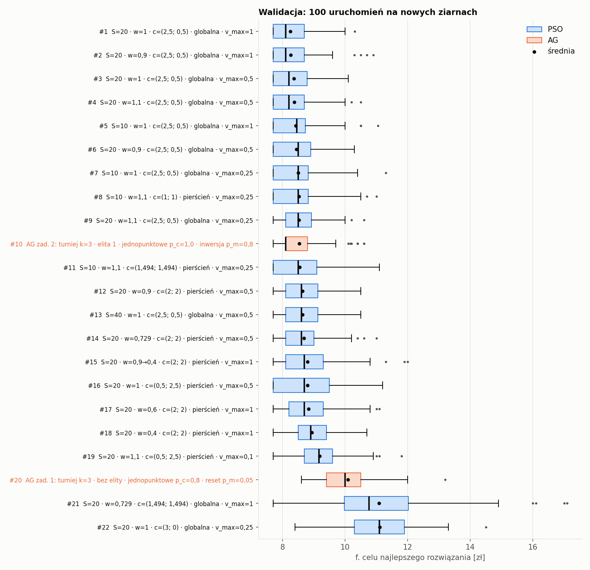
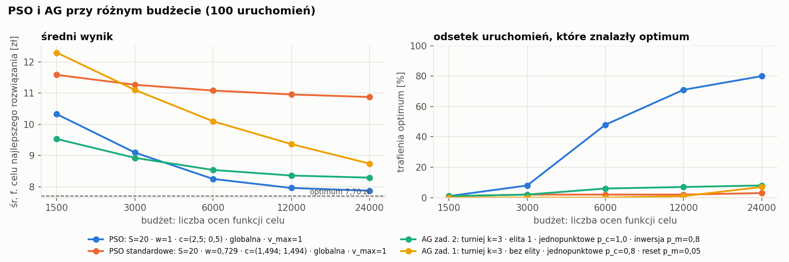

# Zadanie 3: optymalizacja rojem cząstek (PSO) – planowanie diety

Problem z [zadania 1](../Task-1/README.md) rozwiązujemy inną metodą inteligencji obliczeniowej:
**optymalizacją rojem cząstek** (*Particle Swarm Optimization*, PSO). Dobieramy jej parametry i
porównujemy wyniki z algorytmem genetycznym z [zadania 1](../Task-1/README.md) i
[zadania 2](../Task-2/README.md).

Problem i dane ([diet_data.py](diet_data.py)) są takie same jak w zadaniach 1–2:

- szukamy najtańszego jadłospisu z 21 produktów, który spełnia zakresy 5 składników odżywczych,
- rozwiązanie to 21 liczb całkowitych `x_i ∈ {0, …, max_i}` (liczba porcji produktu *i*),
- funkcja celu (minimalizowana) `f(x) = koszt(x) + 200 · V(x)`, gdzie `V(x)` to względne naruszenie
  ograniczeń,
- optimum (z programowania całkowitoliczbowego, tylko do oceny wyników) wynosi **7,70 zł**.

## Dlaczego PSO

Treść zadania proponuje algorytm mrówkowy, pszczeli albo PSO. Wybraliśmy PSO, bo:

- to najczęściej stosowana metoda inteligencji roju, z niewielką liczbą parametrów (`w`, `c1`, `c2`,
  rozmiar roju, topologia, `v_max`), które dobrze nadają się do systematycznego strojenia,
- działa na zupełnie innej zasadzie niż AG: nie ma selekcji, krzyżowania ani mutacji, a cząstki
  „latają” w przestrzeni ciągłej i pamiętają swoje najlepsze położenia. Porównanie z AG jest więc
  ciekawe,
- wymaga przystosowania do problemu całkowitoliczbowego (zaokrąglanie), co samo w sobie jest
  interesującym zagadnieniem.

## Zaimplementowana metoda ([pso.py](pso.py))

| element | wybór |
|---|---|
| **Cząstka** | położenie ciągłe `z = (z_1, …, z_21)`, `z_i ∈ [−0,5; max_i + 0,5]`, i prędkość `v` |
| **Dekodowanie** | jadłospis `x_i = round(z_i)`. Każda wartość całkowita dostaje przedział długości 1, więc przy losowej inicjalizacji wszystkie liczby porcji są równie prawdopodobne |
| **Pamięć** | `p` – najlepsze położenie znalezione przez cząstkę (*pbest*), `g` – najlepsze położenie w jej sąsiedztwie (*gbest* / *lbest*) |
| **Prędkość** | `v ← w·v + c1·r1·(p − z) + c2·r2·(g − z)`, gdzie `r1, r2 ~ U(0, 1)` losujemy osobno dla każdej współrzędnej |
| **Ograniczenie prędkości** | prędkość `v_i` jest obcinana do przedziału `±v_max · (max_i + 1)`, czyli `v_max` to część zakresu zmiennej |
| **Ruch i granice** | `z ← z + v`. Współrzędna, która wyszłaby poza zakres, zatrzymuje się na granicy, a jej prędkość jest zerowana (ściany pochłaniające) |
| **Bezwładność** | stała `w` albo malejąca liniowo od `w_start` do `w_end` |
| **Topologia** | globalna (każda cząstka widzi najlepszą cząstkę roju) albo pierścień (cząstka widzi siebie i dwóch sąsiadów `i − 1`, `i + 1`) |
| **Warunek stopu** | zadana liczba iteracji `T` |
| **Budżet** | rój `S` cząstek przez `T` iteracji wykonuje `S · (T + 1)` ocen funkcji celu, tak jak AG z populacją `S` przez `T` pokoleń |

Do porównania folder zawiera kopię AG z zadania 2 ([ga.py](ga.py), bez zmian). Szczegółowe
wyjaśnienie PSO z przykładem krok po kroku jest w [TEORIA.md](TEORIA.md).

## Uruchomienie

```bash
pip install numpy matplotlib scipy

# pojedyncze uruchomienie, np. najlepsza konfiguracja
python main.py --swarm 20 --iter 300 --w 1.0 --c1 2.5 --c2 0.5 --topology global --vmax 1.0 --seed 1000

# pełne badania (ok. 60 tys. uruchomień, kilka minut na wielu rdzeniach)
python experiments.py
```

## Metodyka badań ([experiments.py](experiments.py))

Każde uruchomienie ma **ten sam budżet** co AG z zadań 1–2: ok. **6000 ocen funkcji celu**
(AG: N = 20, 300 pokoleń). Wynikiem uruchomienia jest wartość `f` najlepszego znalezionego
jadłospisu (w zł, mniej znaczy lepiej).

**Etap 1: przegląd siatki.** Wszystkie kombinacje parametrów, czyli 3 · 7 · 6 · 2 · 4 =
**1008 konfiguracji**, każda w **30 uruchomieniach** (ziarna 0–29):

| parametr | wartości |
|---|---|
| rozmiar roju `S` (iteracje `T`) | 10 (601), 20 (300), 40 (149) |
| bezwładność `w` | 0,4; 0,6; 0,729; 0,9; 1,0; 1,1; liniowo 0,9 → 0,4 |
| `(c1; c2)` | (1; 1), (1,494; 1,494), (2; 2), (0,5; 2,5), (2,5; 0,5), (3; 0) |
| topologia | globalna, pierścień |
| `v_max` | 0,1; 0,25; 0,5; 1,0 zakresu zmiennej |

**Etap 2: walidacja.** Kandydatów uruchamiamy ponownie **100 razy na nowych ziarnach**
(1000–1099), razem z AG z zadań 1 i 2 na tych samych ziarnach. Kandydaci to:

- 10 najlepszych konfiguracji PSO z etapu 1,
- najlepsza konfiguracja dla każdej wartości każdego parametru,
- standardowe PSO z literatury: `S = 20`, `w = 0,729`, `c1 = c2 = 1,49445`, topologia globalna,
  bez ograniczania prędkości.

**Etap 3: budżet.** Najlepsze PSO, standardowe PSO i oba AG dla budżetów 1500, 3000, 6000, 12000
i 24000 ocen (100 uruchomień każdy).

**Etap 4: analiza.** Te same pomiary dla PSO i AG w trakcie przebiegu: różnorodność populacji
(średnia odległość Hamminga), odsetek nowych rozwiązań i długość kroku, a także rozkład wyników
końcowych. Służą do wyjaśnienia różnic między metodami.

Pełne wyniki są w [results/summary.md](results/summary.md), a sprawozdanie z wykresami w
[SPRAWOZDANIE.md](SPRAWOZDANIE.md).

## Wyniki w skrócie



Najlepsza konfiguracja PSO: **S = 20, w = 1,0, c1 = 2,5, c2 = 0,5, topologia globalna,
v_max = 1,0** (300 iteracji).

Porównanie w walidacji (100 uruchomień, ok. 6000 ocen):

| | PSO (najlepsze) | AG zad. 2 | AG zad. 1 | PSO standardowe |
|---|---|---|---|---|
| średnia f | **8,25 zł** | 8,54 zł | 10,09 zł | 11,08 zł |
| mediana | 8,10 zł | 8,10 zł | 10,00 zł | 10,76 zł |
| luka do optimum | **7,2%** | 10,9% | 31,0% | 43,9% |
| najgorsze uruchomienie | 10,31 zł | 10,60 zł | 13,20 zł | 17,10 zł |
| rozwiązanie dopuszczalne | 98% | 99% | 93% | 95% |
| **znalezione optimum 7,70 zł** | **48%** | 6% | 0% | 2% |



| budżet (ocen) | 1500 | 3000 | 6000 | 12000 | 24000 |
|---|---|---|---|---|---|
| PSO (najlepsze) | 10,33 zł (1%) | 9,10 zł (8%) | **8,25 zł (48%)** | **7,96 zł (71%)** | **7,88 zł (80%)** |
| AG zad. 2 | **9,53 zł (1%)** | **8,93 zł (2%)** | 8,54 zł (6%) | 8,36 zł (7%) | 8,29 zł (8%) |

W nawiasach: odsetek uruchomień, które znalazły optimum.

## Która metoda okazała się lepsza?

**Dostrojone PSO**, przy budżecie z zadań 1–2 i większym:

- daje niższą średnią (8,25 wobec 8,54 zł; test Manna–Whitneya, p = 0,0003),
- znajduje optimum 8 razy częściej (48% wobec 6% uruchomień),
- przy większym budżecie przewaga rośnie (24 000 ocen: 80% wobec 8% trafień), bo AG prawie
  przestaje się poprawiać.

Są jednak trzy zastrzeżenia:

1. **Przy małym budżecie lepszy jest AG.** Krzywe średnich wyników przecinają się przy ok. 3600
   ocenach. Wcześniej AG z elitą jest bardziej „zachłanny” i szybciej znajduje dobre rozwiązania.
2. **PSO jest bardzo wrażliwe na parametry.** Przeciętna konfiguracja PSO z siatki daje 12,46 zł
   (AG z zadania 2: ok. 10,07 zł, czyste losowanie 6020 jadłospisów: 13,15 zł). Standardowe PSO z
   literatury daje 11,08 zł, czyli gorzej niż nawet AG z zadania 1.
3. Najlepiej działa rój, który według teorii **nie jest zbieżny** (`w ≥ 0,9`). To nietypowy wynik,
   wynikający z całkowitoliczbowego charakteru problemu.

## Dlaczego PSO wygrywa (skrót)

Pełne wyjaśnienie jest w [TEORIA.md](TEORIA.md#10-dlaczego-pso-okazało-się-lepsze) i
[SPRAWOZDANIE.md](SPRAWOZDANIE.md).

1. **Brak selekcji na bieżących położeniach.** Cząstka może przejść przez gorsze jadłospisy, bo jej
   najlepsze położenie i tak jest zapamiętane. AG odrzuca gorsze rozwiązania pośrednie, więc nie
   potrafi wyjść z optimów lokalnych za ok. 8,10 zł, od których optimum dzieli zmiana 4 produktów
   naraz (46% uruchomień AG kończy się w przedziale 7,71–8,10 zł, PSO tylko 6%).
2. **Rój niezbieżny nie marnuje ocen.** Po zaokrągleniu mały ruch nie zmienia jadłospisu. Zbieżny
   rój pod koniec ocenia w 80% te same jadłospisy co w poprzedniej iteracji. Najlepsze PSO w 91–99%
   ocenia nowe rozwiązania.
3. **Samoczynne przejście od eksploracji do eksploatacji.** Kroki PSO są proporcjonalne do odległości
   od zapamiętanych dobrych rozwiązań, więc maleją w trakcie przebiegu (5,5 → 2,6 zmienionych
   produktów). Długość kroku AG jest stała (ok. 3,5 produktu), bo zależy tylko od `p_m`.
4. **Silna pamięć indywidualna, słaba współpraca.** `c1 = 2,5 ≫ c2 = 0,5`: każda cząstka bada
   głównie okolice własnego najlepszego położenia, a informacja o najlepszym rozwiązaniu roju
   rozchodzi się powoli. Rój bez współpracy (`c2 = 0`) daje jednak tylko 11,11 zł, więc wymiana
   informacji jest potrzebna.

## Pliki

| plik | zawartość |
|---|---|
| [pso.py](pso.py) | PSO dla problemu diety |
| [ga.py](ga.py) | problem diety i AG z zadania 2 (kopia bez zmian, do porównania) |
| [main.py](main.py) | pojedyncze uruchomienie PSO |
| [experiments.py](experiments.py) | wszystkie badania, tabele i wykresy |
| [diet_data.py](diet_data.py) | dane (bez zmian względem zadania 1) |
| [TEORIA.md](TEORIA.md) | teoria PSO i działanie algorytmu krok po kroku |
| [SPRAWOZDANIE.md](SPRAWOZDANIE.md) | sprawozdanie z wynikami i wnioskami |
| [results/summary.md](results/summary.md) | wszystkie tabele wyników wygenerowane automatycznie |
| [results/screening.csv](results/screening.csv) | etap 1: statystyki 1008 konfiguracji PSO |
| [results/validation.csv](results/validation.csv), [results/validation_runs.csv](results/validation_runs.csv) | etap 2: statystyki i pojedyncze uruchomienia |
| [results/budget.csv](results/budget.csv) | etap 3: wyniki dla różnych budżetów |
| `results/*.png` | wykresy |
