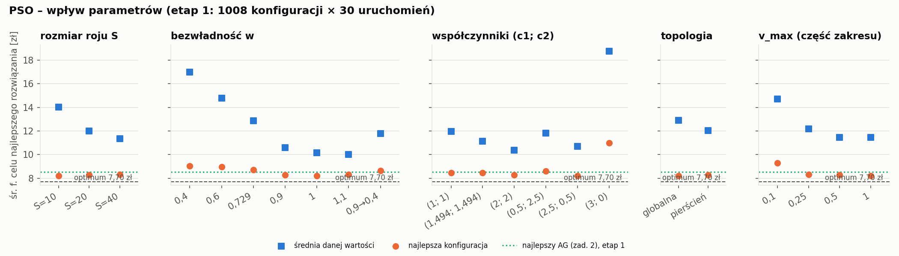
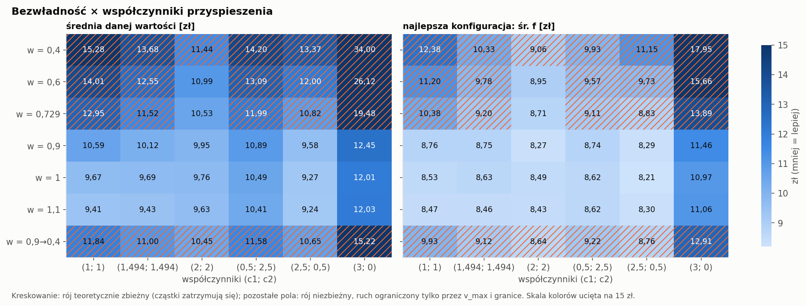
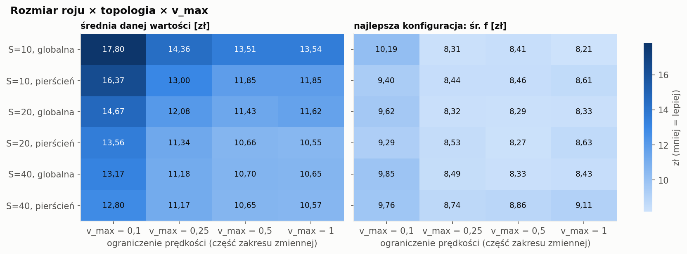
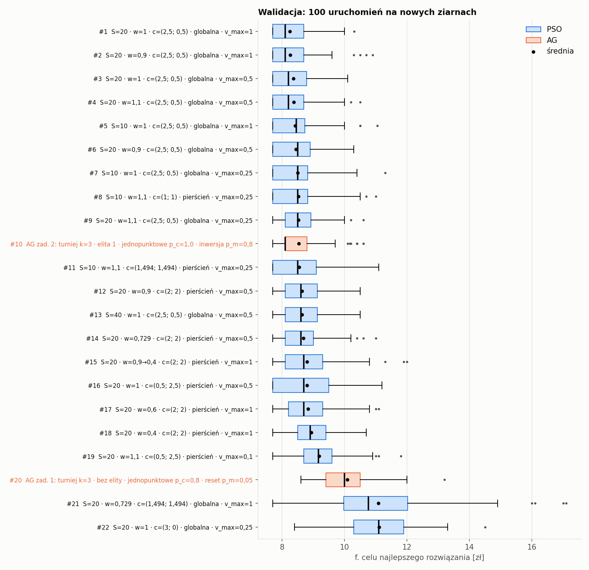
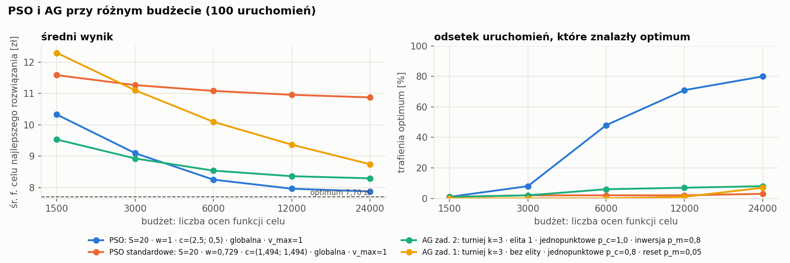
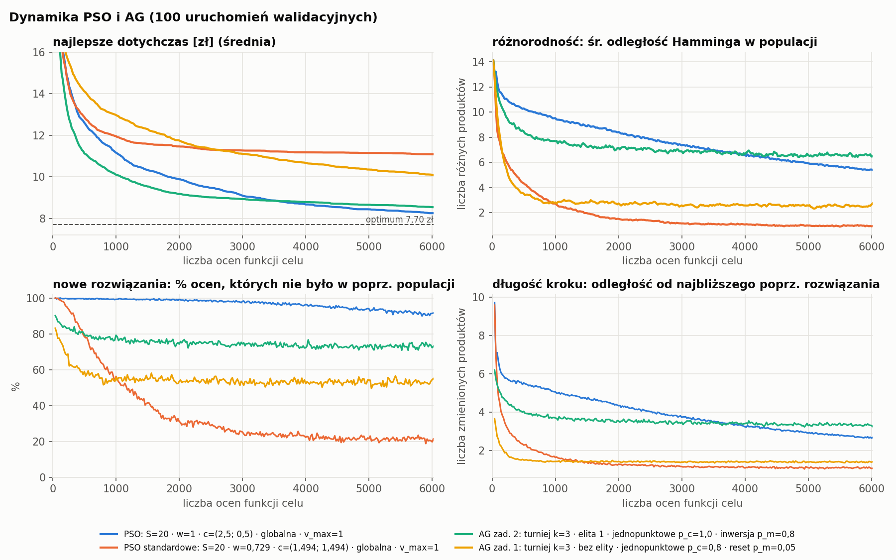
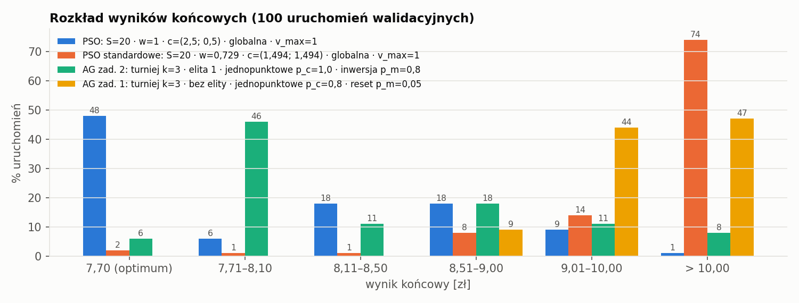

# Sprawozdanie z wyników – zadanie 3

**Cel:** rozwiązać problem diety z zadania 1 optymalizacją rojem cząstek (PSO), dobrać jej
parametry i porównać wyniki z algorytmem genetycznym z zadań 1–2. Optimum (ILP) wynosi
**7,70 zł**.

**Warunki:** każde uruchomienie ma budżet ok. 6000 ocen funkcji celu, tak jak AG z zadań 1–2
(N = 20, 300 pokoleń). Rój `S` cząstek wykonuje `6020 / S − 1` iteracji.

**Przebieg badań:**

1. Przegląd siatki: 1008 konfiguracji PSO × 30 uruchomień (ziarna 0–29).
2. Walidacja: 20 kandydatów PSO i 2 konfiguracje AG × 100 uruchomień na nowych ziarnach
   (1000–1099).
3. Porównanie PSO i AG przy budżetach od 1500 do 24 000 ocen.
4. Analiza dynamiki obu metod (wyjaśnienie wyników).

**Oznaczenia:**

- **S:** rozmiar roju, **w:** bezwładność (`0,9→0,4`: liniowo malejąca), **c = (c1; c2):**
  współczynnik poznawczy i społeczny, **topologia:** globalna lub pierścień, **v_max:**
  ograniczenie prędkości jako część zakresu zmiennej.
- **średnia danej wartości:** średnia ze wszystkich konfiguracji, w których występuje dana wartość
  parametru, niezależnie od ustawień pozostałych parametrów.
- **najlepsza konfiguracja:** najlepiej dostrojona konfiguracja z tą wartością.
- **trafienia opt.:** odsetek uruchomień, które znalazły 7,70 zł.
- **luka do opt.:** o ile procent średni wynik jest gorszy od optimum.
- **dopuszczalne:** odsetek uruchomień, które zakończyły się jadłospisem spełniającym wszystkie
  normy.
- **śr. ocena best:** średni numer oceny funkcji celu, przy której znaleziono najlepsze
  rozwiązanie.
- **rój zbieżny:** cząstki według teorii zatrzymują się (warunek Polego:
  `c1 + c2 < 24(1 − w²)/(7 − 5w)`); **rój niezbieżny:** cząstki nigdy się nie zatrzymują.

---

## Etap 1: przegląd siatki (1008 konfiguracji × 30 uruchomień)

Dla porównania na tych samych ziarnach: AG z zadania 1 – 10,47 zł, AG z zadania 2 – 8,55 zł,
czyste losowanie (najlepszy z 6020 losowych jadłospisów) – 13,15 zł.

### 1. Ogólne zestawienie wyników



#### Rozmiar roju

| rozmiar roju S | średnia danej wartości [zł] | najlepsza konfiguracja: śr. f [zł] | trafienia opt. | najlepsza konfiguracja |
|---|---|---|---|---|
| S=10 | 14,04 | 8,21 | 57% | S=10 · w=1 · c=(2,5; 0,5) · globalna · v_max=1 |
| S=20 | 11,99 | 8,27 | 43% | S=20 · w=0,9 · c=(2; 2) · pierścień · v_max=0,5 |
| S=40 | 11,36 | 8,33 | 33% | S=40 · w=1 · c=(2,5; 0,5) · globalna · v_max=0,5 |

#### Bezwładność

| bezwładność w | średnia danej wartości [zł] | najlepsza konfiguracja: śr. f [zł] | trafienia opt. | najlepsza konfiguracja |
|---|---|---|---|---|
| 0,4 | 16,99 | 9,06 | 10% | S=20 · w=0,4 · c=(2; 2) · pierścień · v_max=1 |
| 0,6 | 14,79 | 8,95 | 13% | S=20 · w=0,6 · c=(2; 2) · pierścień · v_max=1 |
| 0,729 | 12,88 | 8,71 | 13% | S=20 · w=0,729 · c=(2; 2) · pierścień · v_max=0,5 |
| 0,9 | 10,60 | 8,27 | 43% | S=20 · w=0,9 · c=(2; 2) · pierścień · v_max=0,5 |
| 1 | 10,15 | **8,21** | 57% | S=10 · w=1 · c=(2,5; 0,5) · globalna · v_max=1 |
| 1,1 | **10,02** | 8,30 | 37% | S=20 · w=1,1 · c=(2,5; 0,5) · globalna · v_max=0,5 |
| 0,9→0,4 | 11,79 | 8,64 | 30% | S=20 · w=0,9→0,4 · c=(2; 2) · pierścień · v_max=1 |

#### Współczynniki przyspieszenia

| współczynniki (c1; c2) | średnia danej wartości [zł] | najlepsza konfiguracja: śr. f [zł] | trafienia opt. | najlepsza konfiguracja |
|---|---|---|---|---|
| (1; 1) | 11,96 | 8,47 | 33% | S=10 · w=1,1 · c=(1; 1) · pierścień · v_max=0,25 |
| (1,494; 1,494) | 11,14 | 8,46 | 33% | S=10 · w=1,1 · c=(1,494; 1,494) · pierścień · v_max=0,25 |
| (2; 2) | **10,39** | 8,27 | 43% | S=20 · w=0,9 · c=(2; 2) · pierścień · v_max=0,5 |
| (0,5; 2,5) | 11,81 | 8,62 | 33% | S=20 · w=1 · c=(0,5; 2,5) · pierścień · v_max=0,5 |
| (2,5; 0,5) | 10,70 | **8,21** | 57% | S=10 · w=1 · c=(2,5; 0,5) · globalna · v_max=1 |
| (3; 0) | 18,76 | 10,97 | 0% | S=20 · w=1 · c=(3; 0) · globalna · v_max=0,25 |

#### Topologia

| topologia | średnia danej wartości [zł] | najlepsza konfiguracja: śr. f [zł] | trafienia opt. | najlepsza konfiguracja |
|---|---|---|---|---|
| globalna | 12,89 | 8,21 | 57% | S=10 · w=1 · c=(2,5; 0,5) · globalna · v_max=1 |
| pierścień | 12,03 | 8,27 | 43% | S=20 · w=0,9 · c=(2; 2) · pierścień · v_max=0,5 |

#### Ograniczenie prędkości

| v_max (część zakresu) | średnia danej wartości [zł] | najlepsza konfiguracja: śr. f [zł] | trafienia opt. | najlepsza konfiguracja |
|---|---|---|---|---|
| 0,1 | 14,73 | 9,29 | 7% | S=20 · w=1,1 · c=(0,5; 2,5) · pierścień · v_max=0,1 |
| 0,25 | 12,19 | 8,31 | 23% | S=10 · w=1 · c=(2,5; 0,5) · globalna · v_max=0,25 |
| 0,5 | 11,47 | 8,27 | 43% | S=20 · w=0,9 · c=(2; 2) · pierścień · v_max=0,5 |
| 1 | 11,46 | 8,21 | 57% | S=10 · w=1 · c=(2,5; 0,5) · globalna · v_max=1 |

**Wniosek:**

- Największy wpływ ma **bezwładność**: średnia danej wartości spada z 16,99 zł (`w = 0,4`) do
  10,02 zł (`w = 1,1`). Najlepsze są duże wartości `w` (0,9–1,1), większe niż zalecane dla
  problemów ciągłych.
- **Współczynniki:** najgorszy jest brak współpracy (`c2 = 0`: 18,76 zł). Najlepszą konfigurację
  daje przewaga składnika poznawczego (2,5; 0,5).
- **Za małe `v_max`** (0,1) wyraźnie szkodzi, a od 0,25 w górę różnice są niewielkie.
- Rozmiar roju i topologia mają mniejszy wpływ. Przy dobrych parametrach wszystkie warianty
  dają 8,21–8,33 zł.
- PSO jest **bardzo wrażliwe na parametry**: wyniki konfiguracji wahają się od 8,21 do 71,14 zł,
  a przeciętna konfiguracja (12,46 zł) jest gorsza od przeciętnej konfiguracji AG z zadania 2
  (10,07 zł). Dla odniesienia czyste losowanie 6020 jadłospisów daje średnio 13,15 zł, a 271 z
  1008 konfiguracji PSO jest od niego gorszych. Dobrze dostrojone PSO jest jednak lepsze od
  najlepszego AG (8,55 zł): 26 konfiguracji PSO ma średnią poniżej tej wartości.

### 2. Bezwładność × współczynniki przyspieszenia



| zachowanie roju | liczba konfiguracji | średnia [zł] | najlepsza konfiguracja [zł] | trafienia opt. (najlepsza) |
|---|---|---|---|---|
| zbieżny | 528 | 14,42 | 8,64 | 30% |
| niezbieżny | 480 | **10,31** | **8,21** | **57%** |

**Wniosek:**

- **Rój niezbieżny jest wyraźnie lepszy** (średnio 10,31 wobec 14,42 zł). Pola zakreskowane (rój
  zbieżny) są na wykresie zwykle ciemniejsze.
- Przy `w = 0,6` i `0,729` najlepsza jest kolumna (2; 2), czyli jedyna para, która przy tej
  bezwładności daje rój niezbieżny. Przy `w = 0,4` para (2; 2) też jest najlepsza, bo leży tuż
  przy granicy zbieżności (suma 4,0 wobec granicy 4,03).
- Liniowo malejąca bezwładność (0,9 → 0,4), popularna w problemach ciągłych, jest gorsza od stałej
  `w = 0,9–1,1`, bo pod koniec przebiegu rój się zbiega.
- Wyjaśnienie: po zaokrągleniu do całych porcji zbieżny rój przestaje zmieniać jadłospisy i zużywa
  budżet na powtórne oceny (punkt 8).

### 3. Rozmiar roju × topologia × v_max



**Wniosek:**

- Średnio większy rój i pierścień są lepsze, bo łagodzą skutki złych parametrów: pierścień
  spowalnia rozchodzenie się informacji, a duży rój daje więcej różnorodności.
- Po dostrojeniu różnice są małe. Najlepszy wynik daje **topologia globalna** (8,21 zł), a
  pierścień najwyżej 8,27 zł. Przy słabym składniku społecznym (`c2 = 0,5`) rój globalny i tak nie
  zapada się zbyt szybko, więc spowalnianie wymiany informacji przez pierścień nie jest potrzebne.
- `v_max = 0,1` jest najgorsze we wszystkich wierszach: cząstki poruszają się za wolno, żeby przy
  zaokrąglaniu zmieniać jadłospisy.

### 4. Najlepsze i najgorsze konfiguracje

#### 20 najlepszych konfiguracji

| konfiguracja | śr. f [zł] | odch. std | mediana | min | max | luka do opt. | dopuszczalne | trafienia opt. | śr. ocena best |
|---|---|---|---|---|---|---|---|---|---|
| S=10 · w=1 · c=(2,5; 0,5) · globalna · v_max=1 | 8,21 | 0,72 | 7,70 | 7,70 | 10,10 | 6,6% | 100% | 57% | 3680 |
| S=20 · w=0,9 · c=(2; 2) · pierścień · v_max=0,5 | 8,27 | 0,60 | 8,10 | 7,70 | 9,90 | 7,4% | 100% | 43% | 4347 |
| S=20 · w=0,9 · c=(2,5; 0,5) · globalna · v_max=0,5 | 8,29 | 0,62 | 8,10 | 7,70 | 9,65 | 7,7% | 97% | 43% | 4585 |
| S=20 · w=1,1 · c=(2,5; 0,5) · globalna · v_max=0,5 | 8,30 | 0,57 | 8,35 | 7,70 | 9,65 | 7,9% | 97% | 37% | 4445 |
| S=10 · w=1 · c=(2,5; 0,5) · globalna · v_max=0,25 | 8,31 | 0,53 | 8,10 | 7,70 | 9,71 | 7,9% | 97% | 23% | 4374 |
| S=20 · w=1,1 · c=(2,5; 0,5) · globalna · v_max=0,25 | 8,32 | 0,62 | 8,30 | 7,70 | 9,80 | 8,1% | 100% | 37% | 4543 |
| S=20 · w=1 · c=(2,5; 0,5) · globalna · v_max=0,5 | 8,33 | 0,78 | 7,90 | 7,70 | 10,00 | 8,1% | 100% | 50% | 4165 |
| S=40 · w=1 · c=(2,5; 0,5) · globalna · v_max=0,5 | 8,33 | 0,55 | 8,35 | 7,70 | 9,30 | 8,1% | 100% | 33% | 4875 |
| S=20 · w=0,9 · c=(2,5; 0,5) · globalna · v_max=1 | 8,33 | 0,72 | 7,90 | 7,70 | 9,80 | 8,2% | 100% | 50% | 4405 |
| S=20 · w=1 · c=(2,5; 0,5) · globalna · v_max=1 | 8,37 | 0,94 | 8,10 | 7,70 | 12,20 | 8,7% | 100% | 43% | 3807 |
| S=10 · w=1,1 · c=(2,5; 0,5) · globalna · v_max=0,5 | 8,41 | 0,71 | 8,50 | 7,70 | 9,90 | 9,2% | 100% | 43% | 3706 |
| S=10 · w=1 · c=(2,5; 0,5) · globalna · v_max=0,5 | 8,43 | 0,75 | 8,50 | 7,70 | 9,70 | 9,5% | 97% | 43% | 4149 |
| S=20 · w=1,1 · c=(2; 2) · pierścień · v_max=0,5 | 8,43 | 0,74 | 8,50 | 7,70 | 10,00 | 9,5% | 100% | 40% | 4444 |
| S=40 · w=1 · c=(2,5; 0,5) · globalna · v_max=1 | 8,43 | 0,80 | 8,10 | 7,70 | 10,13 | 9,5% | 97% | 40% | 4589 |
| S=10 · w=1,1 · c=(2,5; 0,5) · pierścień · v_max=0,25 | 8,44 | 0,78 | 8,20 | 7,70 | 10,30 | 9,6% | 100% | 37% | 4539 |
| S=10 · w=1,1 · c=(2; 2) · pierścień · v_max=0,25 | 8,45 | 0,64 | 8,60 | 7,70 | 9,90 | 9,7% | 100% | 30% | 4183 |
| S=10 · w=0,9 · c=(2,5; 0,5) · pierścień · v_max=0,5 | 8,46 | 0,77 | 8,50 | 7,70 | 10,50 | 9,8% | 100% | 33% | 4157 |
| S=10 · w=1,1 · c=(1,494; 1,494) · pierścień · v_max=0,25 | 8,46 | 0,71 | 8,50 | 7,70 | 10,40 | 9,9% | 100% | 33% | 4144 |
| S=10 · w=1,1 · c=(1; 1) · pierścień · v_max=0,25 | 8,47 | 0,69 | 8,60 | 7,70 | 10,00 | 10,0% | 100% | 33% | 4503 |
| S=20 · w=1,1 · c=(2,5; 0,5) · globalna · v_max=1 | 8,48 | 0,66 | 8,50 | 7,70 | 10,10 | 10,1% | 100% | 30% | 4341 |

#### 5 najgorszych konfiguracji

| konfiguracja | śr. f [zł] | odch. std | mediana | min | max | luka do opt. | dopuszczalne | trafienia opt. | śr. ocena best |
|---|---|---|---|---|---|---|---|---|---|
| S=10 · w=0,4 · c=(3; 0) · pierścień · v_max=0,25 | 56,94 | 27,05 | 56,02 | 20,57 | 108,18 | 639,5% | 3% | 0% | 60 |
| S=10 · w=0,6 · c=(3; 0) · globalna · v_max=0,1 | 59,00 | 31,13 | 53,62 | 20,30 | 121,50 | 666,2% | 17% | 0% | 83 |
| S=10 · w=0,6 · c=(3; 0) · pierścień · v_max=0,1 | 59,00 | 31,13 | 53,62 | 20,30 | 121,50 | 666,2% | 17% | 0% | 83 |
| S=10 · w=0,4 · c=(3; 0) · globalna · v_max=0,1 | 71,14 | 38,08 | 76,39 | 20,30 | 143,85 | 823,9% | 13% | 0% | 33 |
| S=10 · w=0,4 · c=(3; 0) · pierścień · v_max=0,1 | 71,14 | 38,08 | 76,39 | 20,30 | 143,85 | 823,9% | 13% | 0% | 33 |

**Wniosek:**

- Wszystkie 20 najlepszych konfiguracji ma `w ≥ 0,9`, czyli rój niezbieżny.
- 15 z 20 używa współczynników (2,5; 0,5), a 13 z 20 topologii globalnej. Żadna nie ma
  `v_max = 0,1`.
- Czołówka różni się o 0,27 zł (8,21–8,48 zł), czyli niewiele więcej niż błąd standardowy średniej
  z 30 uruchomień (ok. 0,13 zł). Stąd potrzeba walidacji.
- Wszystkie 5 najgorszych konfiguracji to rój bez współpracy (`c2 = 0`) z małą bezwładnością.
  Każda cząstka szybko zatrzymuje się w okolicy swojego losowego punktu startowego (najlepsze
  rozwiązanie znaleziono średnio przy 33–83 ocenie), a wynik (57–71 zł) jest kilka razy gorszy
  niż z czystego losowania (13,15 zł). Przy `c2 = 0` topologia nie ma znaczenia, stąd identyczne
  wiersze.

---

## Etap 2: walidacja (100 uruchomień, ziarna 1000–1099)

### 5. Porównanie kandydatów

Kandydaci to:

- 10 najlepszych konfiguracji PSO z etapu 1,
- najlepsza konfiguracja PSO dla każdej wartości każdego parametru,
- standardowe PSO z literatury (nr 21: `w = 0,729`, `c1 = c2 = 1,49445`),
- AG z zadania 2 (nr 10) i z zadania 1 (nr 20) na tych samych ziarnach.

Kolumna *p* to wynik jednostronnego testu Manna–Whitneya „najlepsze PSO daje mniejsze f”.



| # | metoda | konfiguracja | śr. f [zł] (etap 1) | śr. f [zł] (walidacja) | odch. std | mediana | min | max | dopuszczalne | trafienia opt. | p |
|---|---|---|---|---|---|---|---|---|---|---|---|
| **1** | **PSO** | **S=20 · w=1 · c=(2,5; 0,5) · globalna · v_max=1** | 8,37 | **8,25** | 0,66 | **8,10** | 7,70 | 10,31 | 98% | **48%** | — |
| 2 | PSO | S=20 · w=0,9 · c=(2,5; 0,5) · globalna · v_max=1 | 8,33 | 8,26 | 0,70 | 8,10 | 7,70 | 10,90 | 100% | 45% | 0,47 |
| 3 | PSO | S=20 · w=1 · c=(2,5; 0,5) · globalna · v_max=0,5 | 8,33 | 8,36 | 0,70 | 8,20 | 7,70 | 10,10 | 98% | 43% | 0,13 |
| 4 | PSO | S=20 · w=1,1 · c=(2,5; 0,5) · globalna · v_max=0,5 | 8,30 | 8,37 | 0,69 | 8,20 | 7,70 | 10,50 | 100% | 36% | 0,083 |
| 5 | PSO | S=10 · w=1 · c=(2,5; 0,5) · globalna · v_max=1 | 8,21 | 8,42 | 0,82 | 8,45 | 7,70 | 11,05 | 98% | 46% | 0,131 |
| 6 | PSO | S=20 · w=0,9 · c=(2,5; 0,5) · globalna · v_max=0,5 | 8,29 | 8,45 | 0,71 | 8,50 | 7,70 | 10,30 | 100% | 35% | 0,014 |
| 7 | PSO | S=10 · w=1 · c=(2,5; 0,5) · globalna · v_max=0,25 | 8,31 | 8,50 | 0,77 | 8,50 | 7,70 | 11,30 | 99% | 32% | 0,00981 |
| 8 | PSO | S=10 · w=1,1 · c=(1; 1) · pierścień · v_max=0,25 | 8,47 | 8,52 | 0,78 | 8,50 | 7,70 | 11,00 | 100% | 30% | 0,0047 |
| 9 | PSO | S=20 · w=1,1 · c=(2,5; 0,5) · globalna · v_max=0,25 | 8,32 | 8,52 | 0,69 | 8,50 | 7,70 | 10,60 | 98% | 24% | 0,00106 |
| 10 | AG | AG zad. 2: turniej k=3 · elita 1 · jednopunktowe p_c=1,0 · inwersja p_m=0,8 | 8,55 | 8,54 | 0,71 | 8,10 | 7,70 | 10,60 | 99% | 6% | 0,000256 |
| 11 | PSO | S=10 · w=1,1 · c=(1,494; 1,494) · pierścień · v_max=0,25 | 8,46 | 8,55 | 0,77 | 8,50 | 7,70 | 11,10 | 98% | 32% | 0,00175 |
| 12 | PSO | S=20 · w=0,9 · c=(2; 2) · pierścień · v_max=0,5 | 8,27 | 8,64 | 0,71 | 8,60 | 7,70 | 10,50 | 99% | 23% | 2,79e-05 |
| 13 | PSO | S=40 · w=1 · c=(2,5; 0,5) · globalna · v_max=0,5 | 8,33 | 8,64 | 0,71 | 8,60 | 7,70 | 10,50 | 98% | 24% | 2,13e-05 |
| 14 | PSO | S=20 · w=0,729 · c=(2; 2) · pierścień · v_max=0,5 | 8,71 | 8,68 | 0,74 | 8,60 | 7,70 | 11,00 | 99% | 21% | 3,82e-06 |
| 15 | PSO | S=20 · w=0,9→0,4 · c=(2; 2) · pierścień · v_max=1 | 8,64 | 8,80 | 0,91 | 8,70 | 7,70 | 12,00 | 99% | 22% | 9,37e-07 |
| 16 | PSO | S=20 · w=1 · c=(0,5; 2,5) · pierścień · v_max=0,5 | 8,62 | 8,80 | 0,93 | 8,70 | 7,70 | 11,20 | 100% | 26% | 3,79e-06 |
| 17 | PSO | S=20 · w=0,6 · c=(2; 2) · pierścień · v_max=1 | 8,95 | 8,83 | 0,77 | 8,70 | 7,70 | 11,10 | 100% | 12% | 7,58e-09 |
| 18 | PSO | S=20 · w=0,4 · c=(2; 2) · pierścień · v_max=1 | 9,06 | 8,94 | 0,71 | 8,90 | 7,70 | 10,70 | 98% | 9% | 2,54e-11 |
| 19 | PSO | S=20 · w=1,1 · c=(0,5; 2,5) · pierścień · v_max=0,1 | 9,29 | 9,18 | 0,73 | 9,16 | 7,70 | 11,80 | 96% | 2% | 3,59e-17 |
| 20 | AG | AG zad. 1: turniej k=3 · bez elity · jednopunktowe p_c=0,8 · reset p_m=0,05 | 10,47 | 10,09 | 0,89 | 10,00 | 8,60 | 13,20 | 93% | 0% | 1,67e-29 |
| 21 | PSO | S=20 · w=0,729 · c=(1,494; 1,494) · globalna · v_max=1 | 10,68 | 11,08 | 1,86 | 10,76 | 7,70 | 17,10 | 95% | 2% | 7,64e-29 |
| 22 | PSO | S=20 · w=1 · c=(3; 0) · globalna · v_max=0,25 | 10,97 | 11,11 | 1,09 | 11,10 | 8,40 | 14,50 | 93% | 0% | 5,19e-33 |

**Wniosek:**

- Najlepsze PSO (nr 1) daje średnio **8,25 zł** i znajduje optimum w **48%** uruchomień.
- Dziewięć konfiguracji PSO ma niższą średnią od najlepszego AG (nr 10: 8,54 zł, 6% trafień), a
  każda z nich trafia w optimum co najmniej 4 razy częściej.
- Nr 1 i 2 różnią się tylko bezwładnością (1,0 i 0,9) i dają praktycznie ten sam wynik (p = 0,47).
  Dobry obszar parametrów jest więc szeroki, a wybór zwycięzcy nie jest przypadkowy.
- Najlepsza konfiguracja z etapu 1 (nr 5: 8,21 zł) w walidacji pogorszyła się do 8,42 zł
  (przekleństwo zwycięzcy). Zwycięzca walidacji poprawił się (8,37 → 8,25 zł).
- **Standardowe PSO z literatury** (nr 21: 11,08 zł) jest gorsze nawet od AG z zadania 1
  (10,09 zł) i niewiele lepsze od czystego losowania (13,15 zł). Bez strojenia PSO na tym
  problemie wypada słabo.

### 6. Porównanie najlepszych konfiguracji PSO i AG

| metoda | śr. f [zł] | odch. std | mediana | min | max | luka do opt. | dopuszczalne | trafienia opt. | śr. ocena best |
|---|---|---|---|---|---|---|---|---|---|
| **PSO (najlepsze)** | **8,25** | 0,66 | 8,10 | 7,70 | 10,31 | **7,2%** | 98% | **48%** | 4071 |
| PSO standardowe | 11,08 | 1,86 | 10,76 | 7,70 | 17,10 | 43,9% | 95% | 2% | 2155 |
| AG zad. 2 | 8,54 | 0,71 | 8,10 | 7,70 | 10,60 | 10,9% | 99% | 6% | 3254 |
| AG zad. 1 | 10,09 | 0,89 | 10,00 | 8,60 | 13,20 | 31,0% | 93% | 0% | 4370 |

Test Manna–Whitneya (najlepsze PSO vs AG zad. 2): p(PSO lepsze) = 0,000256, p(AG lepszy) = 1.

**Wniosek:**

- Przy budżecie z zadań 1–2 **najlepsze PSO jest istotnie lepsze od najlepszego AG**: średnio o
  0,29 zł, z 8 razy częstszym trafieniem w optimum.
- Mediany są równe (8,10 zł), ale rozkłady są różne (punkt 9): PSO często trafia w optimum, a AG
  często kończy w optimum lokalnym za 8,10 zł.
- AG znajduje swoje najlepsze rozwiązanie wcześniej (średnio przy 3254 ocenie, PSO przy 4071). PSO
  poprawia wynik dłużej, co zapowiada wyniki etapu 3.

---

## Etap 3: budżet obliczeń (100 uruchomień)

### 7. PSO i AG przy różnym budżecie



| metoda | 1500 ocen | 3000 ocen | 6000 ocen | 12000 ocen | 24000 ocen |
|---|---|---|---|---|---|
| PSO: S=20 · w=1 · c=(2,5; 0,5) · globalna · v_max=1 | 10,33 zł (1%) | 9,10 zł (8%) | **8,25 zł (48%)** | **7,96 zł (71%)** | **7,88 zł (80%)** |
| PSO standardowe: S=20 · w=0,729 · c=(1,494; 1,494) · globalna · v_max=1 | 11,59 zł (1%) | 11,27 zł (2%) | 11,08 zł (2%) | 10,96 zł (2%) | 10,88 zł (3%) |
| AG zad. 2: turniej k=3 · elita 1 · jednopunktowe p_c=1,0 · inwersja p_m=0,8 | **9,53 zł (1%)** | **8,93 zł (2%)** | 8,54 zł (6%) | 8,36 zł (7%) | 8,29 zł (8%) |
| AG zad. 1: turniej k=3 · bez elity · jednopunktowe p_c=0,8 · reset p_m=0,05 | 12,30 zł (0%) | 11,10 zł (0%) | 10,10 zł (0%) | 9,37 zł (1%) | 8,74 zł (7%) |

W nawiasach: odsetek uruchomień, które znalazły optimum.

**Wniosek:**

- **Przy małym budżecie lepszy jest AG** (1500 ocen: 9,53 wobec 10,33 zł; 3000 ocen: 8,93 wobec
  9,10 zł). Średnie krzywe przecinają się przy ok. 3600 ocenach.
- **Od ok. 4000 ocen lepsze jest PSO**, a jego przewaga rośnie z budżetem. Przy 24 000 ocen PSO
  trafia w optimum w 80% uruchomień, a AG z zadania 2 tylko w 8%.
- AG z zadania 2 po 6000 ocen prawie przestaje się poprawiać (8,54 → 8,29 zł przy czterokrotnie
  większym budżecie), bo utyka w optimach lokalnych za ok. 8,10 zł.
- Standardowe PSO prawie nie korzysta z dodatkowego budżetu (11,59 → 10,88 zł), bo rój szybko
  się zbiega i przestaje badać nowe rozwiązania.

---

## Etap 4: analiza

### 8. Dynamika PSO i AG



Wszystkie wskaźniki to średnie ze 100 uruchomień walidacyjnych:

| metoda | wskaźnik | 500 ocen | 1500 ocen | 3000 ocen | 6000 ocen |
|---|---|---|---|---|---|
| PSO (najlepsze) | najlepsze dotychczas [zł] | 12,60 | 10,33 | 9,10 | **8,25** |
| | różnorodność [produkty] | 10,3 | 8,9 | 7,3 | 5,4 |
| | nowe rozwiązania | 99% | 99% | 98% | 91% |
| | długość kroku [produkty] | 5,5 | 4,7 | 3,7 | 2,6 |
| PSO standardowe | najlepsze dotychczas [zł] | 12,87 | 11,59 | 11,27 | 11,08 |
| | różnorodność [produkty] | 4,3 | 2,0 | 1,1 | 0,9 |
| | nowe rozwiązania | 78% | 41% | 25% | 20% |
| | długość kroku [produkty] | 2,3 | 1,4 | 1,2 | 1,1 |
| AG zad. 2 | najlepsze dotychczas [zł] | **11,13** | **9,53** | **8,93** | 8,54 |
| | różnorodność [produkty] | 8,5 | 7,2 | 6,9 | 6,5 |
| | nowe rozwiązania | 80% | 74% | 74% | 72% |
| | długość kroku [produkty] | 4,0 | 3,6 | 3,5 | 3,3 |
| AG zad. 1 | najlepsze dotychczas [zł] | 14,11 | 12,30 | 11,10 | 10,10 |
| | różnorodność [produkty] | 3,5 | 2,8 | 2,6 | 2,6 |
| | nowe rozwiązania | 59% | 55% | 53% | 54% |
| | długość kroku [produkty] | 1,5 | 1,4 | 1,4 | 1,4 |

Różnorodność to średnia liczba produktów, którymi różnią się dwa rozwiązania populacji. Nowe
rozwiązania to odsetek ocen jadłospisów, których nie było w poprzedniej populacji. Długość kroku
to liczba produktów, którymi nowe rozwiązanie różni się od najbliższego rozwiązania poprzedniej
populacji.

**Wniosek:**

- **Najlepsze PSO prawie nie marnuje ocen:** 91–99% ocen dotyczy nowych jadłospisów. Standardowe
  PSO pod koniec w 80% ocenia jadłospisy, które już były, bo zbieżny rój przestaje zmieniać
  zaokrąglone położenia.
- **PSO samo przechodzi od eksploracji do eksploatacji:** długość kroku spada z 5,5 do 2,6
  produktu, a różnorodność z 10,3 do 5,4. Ruch cząstki jest proporcjonalny do odległości od jej
  najlepszych położeń, które z czasem się do siebie zbliżają.
- **AG ma stałą dynamikę:** krok ok. 3,5 produktu i różnorodność ok. 7 przez cały przebieg, bo
  zależą one od stałego `p_m`. Daje to szybki start, ale pod koniec AG nie dopracowuje rozwiązań.
- Na wykresie widać przecięcie krzywych najlepszego PSO i AG przy ok. 3600 ocenach.

### 9. Rozkład wyników końcowych



| metoda | 7,70 (optimum) | 7,71–8,10 | 8,11–8,50 | 8,51–9,00 | 9,01–10,00 | > 10,00 |
|---|---|---|---|---|---|---|
| PSO (najlepsze) | **48%** | 6% | 18% | 18% | 9% | 1% |
| PSO standardowe | 2% | 1% | 1% | 8% | 14% | 74% |
| AG zad. 2 | 6% | **46%** | 11% | 18% | 11% | 8% |
| AG zad. 1 | 0% | 0% | 0% | 9% | 44% | 47% |

**Wniosek:**

- **AG z zadania 2 utyka w optimum lokalnym:** 46% uruchomień kończy się dokładnie na 8,10 zł.
  Typowy taki jadłospis różni się od optimum czterema produktami (ryż, makaron, mleko, oliwa), a
  wszystkie jadłospisy pośrednie są gorsze, więc selekcja AG je odrzuca.
- **PSO omija tę pułapkę:** na 8,10 zł kończy tylko 6% uruchomień, a 48% znajduje optimum. Cząstka
  nie podlega selekcji: może przelecieć przez gorsze jadłospisy, a dobre rozwiązanie i tak
  przechowuje jej pamięć.
- Gdy PSO nie znajdzie optimum, kończy zwykle w przedziale 8,11–9,00 zł (36%), czyli rozkład jego
  wyników jest „dwubiegunowy”: albo optimum, albo wyraźnie gorzej.

---

## Najlepsza konfiguracja

**PSO: rój S = 20 cząstek, 300 iteracji, bezwładność w = 1,0, c1 = 2,5, c2 = 0,5, topologia
globalna, v_max = 1,0 (cały zakres zmiennej).**

| | AG zad. 1 | AG zad. 2 | **PSO** |
|---|---|---|---|
| średnia f | 10,09 zł | 8,54 zł | **8,25 zł** |
| mediana | 10,00 zł | 8,10 zł | 8,10 zł |
| luka do optimum | 31% | 11% | **7%** |
| najgorsze uruchomienie | 13,20 zł | 10,60 zł | **10,31 zł** |
| rozwiązanie dopuszczalne | 93% | **99%** | 98% |
| znalezione optimum 7,70 zł | 0% | 6% | **48%** |
| znalezione optimum przy 24 000 ocen | 7% | 8% | **80%** |

Najlepsze rozwiązanie znalezione przez PSO (np. ziarno 1000) jest identyczne z optimum wyznaczonym
metodą ILP:

```
Jadłospis:
  2 x Płatki owsiane (100 g)             1.80 zł
  2 x Makaron (100 g, suchy)             1.80 zł
  1 x Soczewica (100 g, sucha)           1.50 zł
  2 x Masło orzechowe (30 g)             1.80 zł
  2 x Oliwa z oliwek (10 g)              0.80 zł
  Koszt łączny:                          7.70 zł
Wartości odżywcze (wymagany zakres):
  kcal       2326.0   [2300, 2500]  OK
  protein      90.0   [90, 160]  OK
  fat          68.5   [60, 90]  OK
  carbs       330.0   [300, 380]  OK
  fiber        41.0   [30, 60]  OK
Dopuszczalne: tak, przystosowanie F = 0.11494
```

### Która metoda okazała się lepsza?

**Dostrojone PSO.** Przy tym samym budżecie co w zadaniach 1–2 (ok. 6000 ocen) daje niższą
średnią (8,25 wobec 8,54 zł, p = 0,0003) i znajduje optimum 8 razy częściej (48% wobec 6%). Przy
większym budżecie przewaga rośnie (80% wobec 8% trafień przy 24 000 ocen).

Zastrzeżenia:

- przy budżecie poniżej ok. 3600 ocen lepszy jest AG,
- PSO wymaga starannego doboru parametrów: przeciętna konfiguracja PSO (12,46 zł) i standardowe
  PSO z literatury (11,08 zł) są gorsze od AG.

### Wyjaśnienie wyników

1. **Brak selekcji pozwala wyjść z optimów lokalnych.** Od optimum lokalnego za 8,10 zł (46%
   wyników AG) dzieli optimum zmiana 4 produktów naraz, a wszystkie jadłospisy pośrednie są gorsze.
   AG odrzuca je selekcją. Cząstka PSO może przez nie przelecieć, bo jej najlepsze położenie jest
   zapamiętane.
2. **Rój niezbieżny nie marnuje ocen.** Po zaokrągleniu do całych porcji małe ruchy nie zmieniają
   jadłospisu. Dlatego na tym problemie lepszy jest rój, który według teorii się nie zbiega
   (`w ≥ 0,9`): 91–99% jego ocen dotyczy nowych jadłospisów, a standardowego PSO tylko 20–41%.
3. **Samoczynne zmniejszanie kroku.** Ruch cząstki jest proporcjonalny do odległości od
   zapamiętanych dobrych rozwiązań, więc PSO zaczyna od dalekich skoków, a kończy na zmianach 2–3
   produktów. AG ma stały rozmiar zmian. To daje AG szybszy start, a PSO lepszy wynik końcowy.
4. **Silna pamięć indywidualna i słaba współpraca** (`c1 = 2,5`, `c2 = 0,5`). Każda cząstka bada
   okolice własnego najlepszego położenia, więc rój prowadzi wiele przeszukiwań naraz i nie zapada
   się w jednym punkcie. Całkowity brak współpracy (`c2 = 0`) jest jednak bardzo zły (11,11 zł).
5. **Ruch ciągły pasuje do struktury problemu.** Koszt i składniki odżywcze są liniowe względem
   liczby porcji, a kodowanie zachowuje porządek wartości (1 porcja leży między 0 i 2). Kierunek
   ruchu, który poprawia jadłospis, pozostaje dobry przez kilka kroków.

### Wnioski końcowe

1. **PSO okazało się lepsze od AG** przy budżecie z zadań 1–2 i większym, przede wszystkim pod
   względem częstości znajdowania optimum (48% wobec 6%).
2. **Kluczowy parametr to bezwładność:** najlepsze są wartości 0,9–1,1, czyli rój niezbieżny. To
   inaczej niż w problemach ciągłych, gdzie poleca się `w ≈ 0,7` lub malejące `w`.
3. **Najlepsze współczynniki to c1 = 2,5, c2 = 0,5:** dużo pamięci indywidualnej, mało współpracy,
   ale nie zero.
4. **Rozmiar roju i topologia** mają mniejsze znaczenie niż `w` i `c`. Za małe `v_max` (0,1)
   wyraźnie szkodzi.
5. **AG jest lepszy przy małym budżecie i bez strojenia.** PSO wymaga doboru parametrów, a jego
   standardowe ustawienia z literatury zawodzą na tym problemie.
6. Zgodnie z twierdzeniem „nie ma darmowego obiadu” wynik dotyczy tego problemu, tego kodowania i
   tego budżetu, a nie wyższości PSO nad AG w ogóle.
